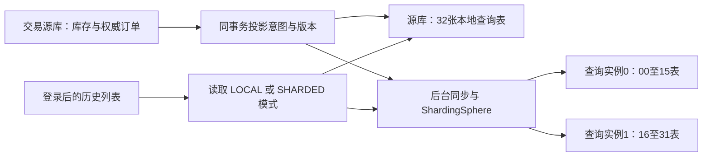

# 05—订单历史查询分库分表

> 本文保留上一阶段历史读模型实现。当前简历已改为CORE32主订单4库×8表，面试请以[09—按参考文档学习核心业务分片](../learning/09-核心业务分库分表-按参考文档学习.md)为准；其中包含可背诵版本、跨库事务边界及维护迁移。下文“保留原交易本地事务”等表述仅适用于旧模式。

> 当前简历的库表字段、关联关系、路由和迁移问答请直接阅读[06—订单分库分表详细面试稿](06-订单分库分表-库表设计与面试详解.md)。

这部分回答的是：学生不断积累历史订单后，怎样按登录用户查询订单，同时保留原有抢票、库存、支付和关单事务。

全文以当前趣票代码及本机验收为依据。当前真实业务量很小，这项工作是用合成数据完成的读模型分片与迁移演练。

## 对应简历

**订单查询分库分表：** 基于 ShardingSphere-JDBC 按用户路由历史订单读模型，落地双查询库、32 张分表；保留交易库本地事务，通过持久化同步任务、版本幂等与差异补偿实现状态同步，支持断点回填、核对切换及故障回退；完成万级迁移、百万级合成数据查询对照和真实登录业务联调。

## 一、两分钟讲法

我先保留原有交易库的本地事务，让库存扣减、建单、支付状态变更和关单回补仍在同一个交易库里完成。历史列表是另一个查询需求，可以接受短暂延迟，因此我将它单独做成订单读模型。

原来已经有同库 32 张订单查询表。这次使用 ShardingSphere-JDBC，把可选历史读模型放到两个独立 MySQL 查询实例，共 32 张表，按登录用户路由。交易库的原始订单和本地查询表都保留，默认仍读本地。

订单变化时，同一个源库事务更新持久化投影任务和版本。后台读取订单快照与版本，先写目标，再按版本条件确认源进度。目标写成功但源进度没确认，恢复后会重复同步；目标只接受更高版本，因此重复或旧任务不会把取消状态覆盖回待支付。

存量回填用持久游标和租约记录进度。回填期间的新订单、取消和支付继续由增量任务覆盖。切换前做完整字段核对和物理路由审计，通过后才开放分片查询；查询节点故障时，可以只连接源库切回本地读模型。

我完成了一万条合成历史订单的回填、断点继续和并发更新验证，另做了百万级合成记录的 JDBC 查询对照，以及真实注册会话下的业务联调。当前小数据 HTTP 中跨实例更慢，所以我把它作为分片与可靠迁移的实现经历，没有写成线上容量或固定性能提升。

## 二、为什么先拆历史读模型

| 业务 | 数据特点 | 当前处理 |
|---|---|---|
| 抢票扣库存、创建订单 | 库存与订单要在一次本地事务内保持一致 | 留在源交易库 |
| 模拟支付、取消、超时关闭 | 需要条件更新及库存回补 | 留在源交易库 |
| 我的历史订单 | 按当前用户分页，允许最终一致 | 使用可切换的读模型 |

如果先把权威订单按用户拆开，热门活动的库存与分散在多个用户分片的订单就可能跨库。当前实现选择保留已有事务边界，先练习历史查询分片、同步及迁移。

这个选择有成本：源库仍是交易容量上限；需要额外保存本地和外部读模型；同步任务也会读取源库。它只迁移了历史列表的查询负载。

当前数据量不能证明线上必须分库分表。面试时说明演练动机：构造万级迁移和百万级查询数据，验证路由、重试、回填及切换过程。

## 三、整体结构



同步任务、本地投影和外部投影进度位于源库。读取模式在源库控制表中保存，因此启用分片后的历史入口仍会访问源库判断模式；Cookie 会话鉴权也访问源库。

ShardingSphere 没有替换源库 DataSource 和事务管理器。默认 Maven 构建不引入它，使用 `sharding` profile 和相应配置才启用外部读模型。随该 profile 打包的 H2 用于 ShardingSphere 内部元数据，业务数据仍存 MySQL。

## 四、分片键与路由

“我的历史订单”始终按登录用户查询，因此选择 `user_id`。订单号继续使用原 UUID。

```text
shard = floorMod(user_id, 32)
database = shard / 16        // 整数除法
table = ux_order_read_XX     // XX 是 00 至 31 的全局编号
```

| user_id | 分片编号 | 实际位置 |
|---:|---:|---|
| 6 | 6 | history0.ux_order_read_06 |
| 22 | 22 | history1.ux_order_read_22 |
| 38 | 6 | history0.ux_order_read_06，与用户6共表但查询条件不同 |

逻辑表是 `ux_order_history`。history0 只有 00–15，history1 只有 16–31；不是每个实例都创建 32 张外部表。

查询 SQL 仍携带 `WHERE user_id=?`。分片只缩小物理位置，同一张表内有多个用户，用户隔离仍依赖登录身份和 SQL 条件。

入口从 `Auth.Identity` 取得用户，不采用查询参数里的 userId。应用不提供无用户条件的历史搜索或仅凭订单号定位分片的接口；范围路由在自定义算法中拒绝。不能将这一应用约束说成“ShardingSphere 自动拒绝所有缺失分片键的 SQL”。

表上有 `(user_id, created_at, id)` 联合索引，列表按创建时间和 ID 倒序，当前每页 20 条、最多 500 页，使用 OFFSET。没有实现游标分页或跨分片全局排序。单个重度用户仍落在一个分片，不会因增加实例而自动分散。

## 五、源库提交后如何可靠同步

`OrderProjection.changed` 要求在订单事务中调用。创建订单、取消或支付变更与该订单的投影版本更新一起提交。

主要进度字段：

| 字段 | 用途 |
|---|---|
| revision | 源订单读模型版本 |
| applied_revision | 原同库读模型已应用的版本 |
| replica_revision | 外部读模型已确认的版本 |
| replica_next_at / replica_attempts | 外部失败的重试时间和次数 |
| replica_pending | 判断外部已确认版本是否落后于源版本的生成列 |

本地、外部进度分别确认，外部故障不会将本地任务标成已完成或撤销已提交的交易。

后台流程：

1. 一条源库查询读取订单事实及投影版本，例如 revision=8。
2. 携带 `user_id`，向目标读模型写入版本8。
3. 目标提交后，在源库执行条件确认：只有源版本仍是8，才能把外部确认进度推进到8。
4. 如果源库期间已变成9，旧任务不能把它标成已完成，版本9仍会被后续任务处理。

源库和目标之间没有一个共同事务。远程写入发生在源交易事务之外，不占着活动行锁等待网络。目标失败时保存重试信息，退避上限60秒；本轮每批首个目标错误后停止该批，避免整批反复等待连接超时。

同步默认每秒触发，批量默认100，属于最终一致。HTTP 响应标记 `eventual`，付款或取消的裁决仍使用权威订单。

这里与建单 Kafka 链路分开：Kafka 负责将已受理请求推进为订单；历史跨库同步当前由源库投影任务轮询完成，没有新增第二条 Kafka 同步链路，也没有实现 Binlog CDC。

## 六、三个关键故障窗口

| 窗口 | 恢复行为 |
|---|---|
| 源订单和投影意图提交后，目标尚未写入 | 源库任务仍落后，恢复后继续同步 |
| 目标写入成功，源确认前进程退出 | 恢复后重复写目标，靠版本幂等收敛 |
| 写目标期间，源订单由待支付变成取消 | 旧版本条件确认不成功，继续同步较新版本 |

目标 upsert 只有在传入版本更高时更新字段。例如目标已是版本9、状态 CANCELLED，再到达版本8的 PENDING_CONFIRM，不会回退状态。版本字段在更新语句最后赋值，前面的字段比较始终针对原版本。

正常的重复和乱序可以收敛。人工篡改 user_id、把行放进错误分片或写入不可信的异常超前版本，不能仅靠普通重放修复全部情况；这些情况需要核对和人工处置。

## 七、已有数据如何迁移，为什么要保留增量任务

回填以 UUID 的排序位置作分页游标，每批写目标后再保存检查点。游标、完成标识、任务 owner 和租约保存在 `ux_history_control`。

领取回填使用源库事务及行锁，租约默认30秒。保存回填检查点时要求 owner 匹配且租约仍有效。写目标后进程退出、检查点未保存，下次会重复该批，由目标版本规则处理。

UUID 排序不等于创建或提交顺序。游标已经经过某个位置后，仍可能有订单在它之前提交。因此，回填不是增量变更的唯一水位：订单事务持续写投影意图，新增和状态变化由增量任务继续覆盖。

迁移步骤是：保持 LOCAL，完成回填，等待同步，执行核对，修复差异，再核对通过后切 SHARDED。迁移本身不要求重新生成源交易数据。

## 八、核对与切换实际检查了什么

核对覆盖订单与请求 ID、user_id、活动、金额、状态、创建/确认时间、版本，以及活动名称、票档和图片等展示字段。另直接检查32张物理表的路由位置和总行数。

缺行或内容不同，会提升源投影版本并重新排入同步。发现差异的这一轮不会直接宣布通过；需要同步修复，再完整核对。

切 SHARDED 检查回填完成、存在成功核对标记、外部无待同步任务，并记录操作者审计。核对是运行中分批扫描，切换条件也是检查当时的状态，不能描述为全局一致快照或切换后永远没有延迟。

多余行、错误归属、错分片和异常超前版本会阻止核对通过；系统没有自动删除不明数据或自动修复所有人为篡改的能力。库数量和取模规则固定，改配置不是在线扩容方案。

## 九、目标库不可用时怎样回退

已经启动的应用在 SHARDED 模式遇到目标查询失败，会返回503；没有自动对所有请求改查权威订单表。管理员可切回 LOCAL，继续使用持续维护的本地读模型。

离线 `sharding-local.ps1 local` 只需要源库连接，不创建查询实例连接，因此目标实例完全不可用时仍有回退路径。LOCAL 本身也是最终一致的读模型，实时状态操作继续使用源订单。

应用冷启动与运行中回退要区分。启用外部分片后，初始化组件可能需要目标元数据；不能承诺目标库不可用时应用一定能正常冷启动。离线回退命令专门保留了源库独立操作路径，启动问题仍需按运行配置处理。

## 十、数据与性能怎么回答

| 验证 | 实际规模与结论 |
|---|---|
| 历史迁移 | 一万条合法合成历史订单，101批回填，覆盖检查点继续及并发更新，最终差异与错分片为0 |
| 查询布局对照 | 10万和100万条合成读模型记录，比较单表、同库32表和双实例32表；JDBC层、每模式并发8、三轮各3秒 |
| 完整业务联调 | 真实注册登录，经 Redis、源库、Kafka、支付/取消及历史接口，覆盖组件中断与恢复 |
| 登录后 HTTP 对照 | 17个会话、8个线程、每次后等待25ms，每模式三轮各10秒，共8942次稳定请求，无错误或核对差异 |

HTTP 三轮 P95 中位数为 LOCAL 31.53ms、SHARDED 71.80ms。这组少量订单中跨实例更慢，不能宣称分片必然提速。它与百万级 JDBC 数据不是同一实验，更不能拼成“百万订单下 HTTP 达到某吞吐”。

新增和取消到分片 HTTP 首次可见约为1211ms、477ms，是300ms间隔轮询的单次观测；包含脚本开销，不是生产 SLA。

代码回归最近一次为158项：145通过、13条件跳过、0失败。跳过的是前轮已单独执行的分片实验条件测试，原有49项外部中间件及客户HTTP测试在本轮启用。不要把158说成全部执行通过。

## 十一、常见追问

**只有这点业务量，为什么做分库分表？**

实际业务量不足以证明必须拆库。我做的是读模型扩展与迁移演练，构造规模化数据验证路由、幂等、断点回填和回退。当前保留默认 LOCAL。

**是不是主订单分库了，靠分布式事务保持库存一致？**

权威订单和库存仍在源库本地事务内。跨库的是历史读模型，采用至少一次同步和版本幂等，允许短暂延迟。

**为什么不只加索引或归档？**

真实选型应先看查询计划、数据规模、热度和保留周期。当前读模型也有用户索引；跨实例增加路由、网络、同步和运维成本。这个项目没有证明所有单库方案都已达到上限。

**为什么不用订单号当分片键或顺便改雪花 ID？**

主要入口按当前用户看历史，按用户路由更直接。保留现有 UUID，避免为了读模型扩展再修改交易 ID；仅凭订单号跨分片查询不在本次接口范围。

**将来从2个查询库改成4个，直接改取模行吗？**

不行。位置会变化，需要新拓扑、数据搬迁、增量同步和核对切换；当前没有实现自动在线扩容。

**查询库挂了能彻底摆脱源库吗？源库挂了分片能独立服务吗？**

回退依赖源库和本地读模型。分片入口的模式判断与 Cookie 会话也依赖源库，因此不能声称交易库故障时历史接口仍独立可用。

## 代码与证据

- [投影任务与原本地查询](../../backend/src/main/java/com/hmdp/upgrade/OrderProjection.java)、[外部同步与维护](../../backend/src/main/java/com/hmdp/upgrade/ExternalOrderHistory.java)、[查询入口](../../backend/src/main/java/com/hmdp/upgrade/OrderProjectionApi.java)。
- [路由算法](../../backend/src/sharding/java/com/hmdp/upgrade/sharding/HistoryShardingAlgorithm.java)、[ShardingSphere 配置与物理审计](../../backend/src/sharding/java/com/hmdp/upgrade/sharding/ShardedHistoryReplica.java)、[目标版本写入](../../backend/src/main/java/com/hmdp/upgrade/HistoryRows.java)。
- [分片验收](../verification/2026-10-27-sharding/README.md)、[完整业务验收](../verification/2026-10-27-full-integration/README.md)、[运行迁移说明](../learning/07-订单查询分库分表.md)。
