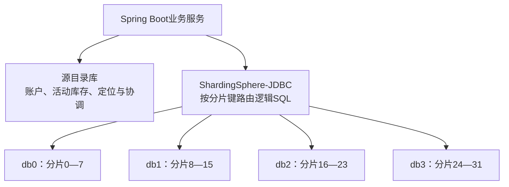
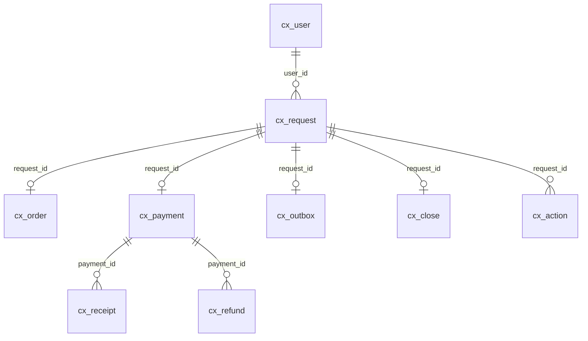
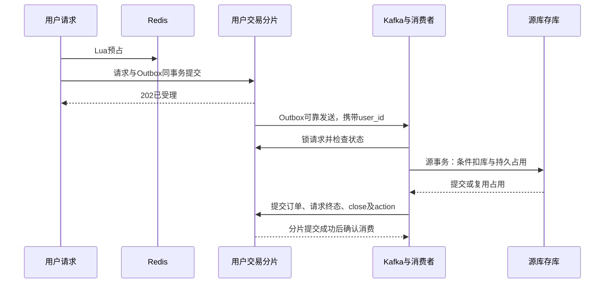

# 趣票订单分库分表：库表设计与面试详解

2026-10-29 更新：消息链路已改为 RocketMQ 异步建单与延迟关单。下文 Kafka、Redis 关单 ZSet 的说明属于此前实现；数据库结构、库存与支付并发设计仍可参考，消息部分以[RocketMQ 改造说明](../engineering/RocketMQ迁移与验收.md)为准。

整理日期：2026-10-28。本文按当前CORE32代码、建表脚本及留存验收记录编写，重点解释“为什么这样拆、每张表负责什么、拆完业务如何运行”。

## 一、这份文档对应哪条简历

> **订单查询分库分表：** 针对订单数据集中、单库读写压力难以分摊的问题，按用户ID取模，将订单、请求和支付流水水平拆分为4库×8表，使同一用户的关联数据落在同一分片，支持旧数据迁移、校验与回退。

面试开场先说明：这条实际包含**主订单及关联交易数据的读写拆分**。用户看到的是下单、支付和订单查询功能，后端请求、订单、支付、消息及任务均已适配分片。标题使用“订单分库分表”会更准确；这里只沿用用户提供的简历原句。

此前项目还有“双查询库历史读模型”方案，那是另一阶段。本篇讨论四个主交易实例，不使用旧读模型的迁移规模和性能数字证明本方案。

可以把简历逐句拆成下面几个问题：

| 简历中的话 | 面试官想了解什么 | 回答重点 |
|---|---|---|
| 订单数据集中、压力难分摊 | 为什么要拆 | 订单增长、单实例集中承载，以及选择分片的成本 |
| 按用户ID取模 | 为什么选这个字段 | 核心读写围绕用户，同用户关联数据可以放一起 |
| 4库×8表 | 数据具体在哪 | 四个独立MySQL实例；每类分片表总计32张物理表 |
| 订单、请求、支付流水一起拆 | 为什么不只拆订单 | 请求与消息、订单与支付等需要就近关联和本地事务 |
| 同一用户落同一分片 | 怎么保证 | 所有用户交易表采用相同分片键、相同算法和绑定配置 |
| 迁移、校验与回退 | 旧业务如何安全切换 | 持久变更日志、按用户回填、字段核对、维护切换及反向复制 |

建议先掌握第二至第八节的结构和路由，再看交易、迁移及问答，最后练习口述版本。

## 二、为什么做：从业务问题讲起

### 2.1 原来的数据集中在哪里

趣票面向校园活动抢票。用户提交请求，后台异步创建订单，之后可以支付、取消或等待超时关闭。早期用一个MySQL实例保存活动库存、请求、订单、支付和任务，开发和事务处理都比较直接。

订单会随时间累积。不同用户集中抢票时，请求、订单、消息任务和支付流水也会集中写入同一个实例。应用增加实例后，这些应用仍访问同一数据库，数据库负载没有因此自动分散。

本次设计针对这类增长场景，把用户交易数据放到多个实例，让不同用户的数据量和读写由多个节点承接。

### 2.2 五个目标分别对应什么措施

| 问题 | 本项目的措施 | 需要说明的取舍 |
|---|---|---|
| 单实例连接和处理能力有限 | 四个主交易实例分别承接用户读写 | 连接池仍要限额，源库认证和库存仍需单独管理 |
| 主订单单表持续增长 | 每类用户交易表拆成32张 | 索引和SQL仍要优化，不能按统一行数判断是否必须拆 |
| 不同用户的订单写入集中 | 根据用户ID分散到不同库表 | 同一用户仍在一片，同一活动库存仍有集中锁 |
| 存储与恢复单元过大 | 主订单数据分散到多个实例和表 | 多表会增加固定开销；主从容灾不是分片自动提供的 |
| 只依赖单机升配 | 形成多实例承载用户交易的布局 | 固定32片进一步扩容仍需搬迁，不是自动弹性扩容 |

**口述时可以这样讲：**

> 我关注的是订单随时间增长以及多用户集中下单时，单库单表承担全部交易读写的问题。因此按用户拆分主订单及关联数据，让不同用户的交易落到不同实例，同用户的数据仍放在一起，减少拆库后查询和事务处理的复杂度。

### 2.3 为什么还要先优化SQL、索引和缓存

缓存可以减少活动介绍等重复读取，索引可以减少查询扫描；它们与分片解决的问题不同。没有分片键、缺索引的SQL不会因为分成32表就自动合理。

本项目真实业务量较小，分片属于面向增长的架构实现与验证。我们构造了百万条合成主订单验证布局与访问表现，不能将它讲成已经发生的线上千万订单故障。实际实验结果集中放在第十三节说明。

## 三、库的结构：1个源库＋4个交易分库

### 3.1 先区分三个词

| 名称 | 含义 | 本项目示例 |
|---|---|---|
| MySQL实例 | 一个独立运行的数据库服务进程 | 端口33400与33401是不同实例 |
| 数据库/schema | 实例内的一组表 | 四个目标实例都可使用qupiao_core32这个schema名 |
| 物理表 | MySQL实际创建的表 | cx_order_0、cx_order_1 |

四个实例使用相同schema名不会混淆，因为连接地址不同。db0、db1等是ShardingSphere中的数据源名称。

### 3.2 实际部署位置

| 位置 | 本机端口 | schema | 主要职责 |
|---|---|---|---|
| 源目录库 | 33307 | qupiao_core_catalog | 账户、会话、活动库存、定位目录及协调记录 |
| db0 | 33400 | qupiao_core32 | 逻辑分片0—7 |
| db1 | 33401 | qupiao_core32 | 逻辑分片8—15 |
| db2 | 33402 | qupiao_core32 | 逻辑分片16—23 |
| db3 | 33403 | qupiao_core32 | 逻辑分片24—31 |

这里是**四个主交易分库之外保留一个源库**，并非整套系统只有四个库。四个目标实例具有不同server_uuid；本机演练中它们共享一台机器，不能当作四台独立硬件的性能结果。



### 3.3 什么叫水平分库、水平分表

- **水平分库：** 同一类订单的不同行，按用户分布到四个实例。
- **水平分表：** 每个实例内再把订单分到八张表。
- **垂直分表：** 按字段拆表，例如把大段详情拆离常用字段。本次主订单分片不是这种方式。

源库与交易库还存在职责上的分离，但简历中“按用户ID取模、4库×8表”具体讲的是水平拆分。

## 四、交易分库里有哪些表

### 4.1 每个库的物理表布局

下面以db0为例；db1、db2、db3的表名结构相同，保存的数据不同：

```text
db0 / qupiao_core32
├── cx_user_0       ... cx_user_7
├── cx_request_0    ... cx_request_7
├── cx_order_0      ... cx_order_7
├── cx_outbox_0     ... cx_outbox_7
├── cx_action_0     ... cx_action_7
├── cx_payment_0    ... cx_payment_7
├── cx_receipt_0    ... cx_receipt_7
├── cx_refund_0     ... cx_refund_7
├── cx_close_0      ... cx_close_7
├── cx_check_log_0  ... cx_check_log_7
└── cx_event
```

前九类表按用户ID分片；cx_check_log按订单号哈希分片；cx_event是每库一份的展示配置广播表。

按当前配置计算，每库有9×8张用户交易表、8张事件日志表、1张广播表，共81张；四库合计324张。这个数字描述配置中的目标表，不包含源库、旧版本残留表、框架元数据及独立测试schema。**4库×8表指每一类分片表有32张，不是整个项目只有32张表。**

### 4.2 每类表的职责

| 逻辑表 | 存什么 | 为什么需要 | 路由依据 |
|---|---|---|---|
| cx_user | 用户业务档案 | 提供用户数据，并作为用户维度并发锁定入口 | user_id |
| cx_request | 抢票请求、请求键、处理状态 | 支持异步结果查询、重试去重和到期处理 | user_id |
| cx_order | 主订单、金额、订单状态、付款期限 | 作为新模式权威订单 | user_id |
| cx_outbox | 待发消息、发送租约、重试时间 | 请求提交后，消息发送失败仍有记录可重试 | user_id |
| cx_action | 回补库存、写定位目录、记录事件等任务 | 将订单提交后的后续工作持久化 | user_id |
| cx_payment | 模拟支付流水 | 记录应付金额及支付状态，关联订单对应请求 | user_id |
| cx_receipt | 付款通知及处理结果 | 对同一通知重复处理时返回已有结果 | user_id |
| cx_refund | 退款任务、重试状态 | 订单关闭后到账等情况需要继续退款 | user_id |
| cx_close | 关单时间及执行状态 | Redis到期触发之外，还需要数据库兜底 | user_id |
| cx_check_log | 订单状态事件 | 通过订单号追踪创建、确认和关闭等事件 | order_id字符串哈希 |
| cx_event | 活动名称、票档名称等展示配置 | 在订单所在库完成展示信息关联 | 每库完整副本 |

Outbox和action的区别：**Outbox负责把已受理请求送给Kafka；action负责订单处理之后还要完成的工作。** 两者的重试对象不同。

## 五、重点表的字段、关系和约束

### 5.1 用户业务档案cx_user

| 字段 | 含义 |
|---|---|
| user_id，BIGINT主键 | 用户ID，同时决定分片 |
| username、display_name | 用户名和展示名 |
| created_at | 创建时间 |
| copy_revision | 数据迁移已经应用的版本，通过目标表升级脚本增加 |

登录密码仍在源库ux_account，用户名全局唯一性也由源库保证。cx_user保存业务档案，不能把它讲成“整个登录系统已经分库”。

### 5.2 抢票请求cx_request

| 字段 | 含义 |
|---|---|
| id，VARCHAR(36)主键 | 服务端请求ID |
| user_id | 所属用户、分片键 |
| request_key | 客户端重试时沿用的请求键 |
| activity_id | 抢哪个活动票档 |
| order_id | 预先分配的订单号，存在该值不代表订单已经建成 |
| state、reason | 请求状态及失败原因 |
| created_at、deadline、completed_at | 创建、处理截止和完成时间 |
| reservation_epoch | 对应的Redis预占恢复版本 |

关键约束为UNIQUE(user_id, request_key)。相同用户和请求键重复提交，业务返回原请求结果，不再创建第二个请求。相同请求键换了活动则拒绝。

请求状态为ACCEPTED、SUCCEEDED、REJECTED、EXPIRED。ACCEPTED表示已持久受理，SUCCEEDED表示已创建订单，不能把HTTP 202当成已经购票成功。

主要索引：

```sql
UNIQUE (user_id, request_key)
INDEX cx_request_user (user_id, created_at, id)
INDEX cx_request_due (state, deadline)
```

分别服务请求去重、用户请求列表和到期请求扫描。

### 5.3 主订单cx_order

| 字段 | 含义 |
|---|---|
| id，VARCHAR(36)主键 | 订单号 |
| user_id | 所属用户、分片键 |
| request_id | 对应抢票请求 |
| activity_id | 活动票档ID |
| price_cents | 成交金额，单位分，使用整数 |
| state | PENDING_CONFIRM、CONFIRMED、CANCELLED或EXPIRED |
| confirm_until | 付款/确认截止时间 |
| created_at | 创建时间 |

```sql
UNIQUE (request_id)
UNIQUE (user_id, activity_id)
INDEX cx_order_user (user_id, created_at, id)
INDEX cx_order_due (state, confirm_until)
```

request_id唯一防止同一请求重复建单；用户与票档唯一约束限制一人一票档一单；用户时间索引服务订单列表，状态时间索引服务到期处理。

当前唯一约束的语义是同用户同票档最多建立一笔订单。即使原订单取消，也不能随意再插一笔相同用户、票档的新订单。如果业务改为允许取消后重购，唯一约束和购买规则都需要一起调整。

订单保存成交金额，而不是查询时临时取活动最新价格，避免活动配置改变后影响已有订单金额。

### 5.4 模拟支付流水cx_payment

| 字段 | 含义 |
|---|---|
| id | 支付流水号 |
| user_id | 用户和分片键 |
| request_id，唯一 | 关联的请求，一次请求最多创建一笔本地支付流水 |
| amount_cents | 应付金额，单位分 |
| state | OPEN、PAID、REFUND_PENDING、REFUNDED |
| created_at | 创建时间 |

支付表通过request_id关联请求和订单，当前没有order_id字段。查询订单与支付时，需要说明实际关联键，不能只凭表名猜关系。

付款通知保存在cx_receipt，其channel_id为主键；退款任务保存在cx_refund，也按channel_id识别。由于不同用户可能在不同分片，分片表内的主键不能独自提供跨四库的通知唯一性，因此源库还保留全局付款通知记录。

### 5.5 关单与后续任务

| 表 | 主要字段 | 用途 |
|---|---|---|
| cx_close | request_id、user_id、due_at、done_at、next_enqueue_at | 保存关单到期时间、执行结果与再次投递时间 |
| cx_outbox | id、request_id、user_id、sent_at、owner、lease_until、attempts、next_at | 协调消息发送、失败重试和并发认领 |
| cx_action | id、user_id、request_id、kind、done_at、attempts、next_at | 保存库存回补、目录写入、事件记录等后续动作 |

cx_action有UNIQUE(user_id, request_id, kind)，同一请求同一种动作不会重复创建。真正执行外部效果时仍需要库存账本、Redis状态或目标唯一键提供幂等，不能只因为任务表去重就认为外部操作不会重复。

### 5.6 核心关联关系

下面表示业务逻辑关联，不表示存在跨库外键。订单和支付都通过request_id关联请求。



分片目标表主要依赖应用检查、唯一约束和本地事务维护关系，没有照搬旧源表的外键。请求尚未成功时，可能没有订单；异常预占清理产生的过期请求也可能没有Outbox。

## 六、源库为什么保留，这里面有哪些表

### 6.1 源库表的分工

| 业务 | 表 | 为什么放这里 |
|---|---|---|
| 登录 | ux_account、ux_session | 用户名全局唯一、密码和会话统一管理 |
| 展示与票档 | ux_shop、ux_storefront、ux_offer | 活动基础介绍、分类地点、票档关联，沿用部分旧表名 |
| 活动库存 | ux_activity | 活动总票额、可售票额、价格和售卖时间统一裁决 |
| 库存占用 | ux_core_stock_hold | 记录请求是否已经扣过SQL库存、是否已释放 |
| 库存恢复版本 | ux_core_reservation_epoch | 记录活动预占重建的epoch |
| 订单定位 | ux_core_order_route | 根据订单号找到user_id，随后定位分片 |
| 全局付款通知 | ux_core_channel_claim | 防止同一通知被跨用户、跨分片重复占用，并支持未处理通知恢复 |
| 模拟退款 | ux_core_provider_refund | 以channel_id记录模拟渠道退款，支持重试去重 |
| 候补 | ux_waitlist | 队列主要按活动排队，补位后再进入用户分片交易 |
| ID协调 | ux_core_id_worker | 保存worker租约和可安全使用的时间范围 |
| 迁移 | ux_core_copy_user、ux_core_migration、ux_core_control | 用户版本、复制进度、验证结果和运行模式 |
| 缓存与排错 | ux_invalidation、ux_shop_index_guard、ux_poison、ux_audit | 缓存失效、Bloom协调、异常消息和审计 |

旧ux_request、ux_order、ux_payment等交易表保留，用于旧模式、迁移和回退；新主交易模式查询的权威订单是cx_order。可选规划模块另有任务与场次表，不是本条简历的讲解重点。

### 6.2 库存占用表ux_core_stock_hold

| 字段 | 含义 |
|---|---|
| request_id，主键 | 用哪个请求取得的占用 |
| user_id、activity_id | 谁购买哪个票档 |
| price_cents | 取得占用时保存的权威价格 |
| state | HELD或RELEASED |
| created_at、released_at | 创建和释放时间 |

另有UNIQUE(activity_id, user_id)。源库事务将条件减库存和写入占用记录一起提交。消费者重试时若发现同请求已有HELD记录，就复用占用，不再扣一次。

HELD不只是“短暂等待付款”的意思：已确认订单仍占用票额，记录可以继续保持HELD；取消或到期关闭后才变为RELEASED。它不会单凭自身存在时间就自动释放。

可核对的不变量是：

```text
活动可售票额 + 该活动HELD记录数 = 活动总票额
```

请求可能已在Redis预占、但还没取得SQL占用，所以不能在任何时刻都用“SQL订单数”直接替代占用记录数。

### 6.3 订单定位表ux_core_order_route

保存order_id、user_id、request_id、created_at。查询过程为：

```text
订单号 → 源库查user_id → 计算分片 → 查询对应订单表
```

它是订单号到分片键的目录，不存整份订单。目录由订单事务内产生的任务异步写入，短暂未就绪时返回未就绪/未找到，不立即扫描全部32张订单表。

源库的占用、目录等表仍会随交易增长，这是当前架构继续需要治理的部分。拆主订单不等于源库从此没有增长或瓶颈。

## 七、怎么路由：从用户ID算出库和表

### 7.1 三步计算

```text
全局逻辑分片数 = 4 × 8 = 32

shard = user_id % 32
dbIndex = shard / 8       // 整数除法
tableIndex = shard % 8
```

用户ID必须为正数。当前代码直接对数值用户ID取模，并没有先额外套一层字符串哈希。

| user_id | shard | 库 | 表后缀 | 订单实际位置 |
|---:|---:|---|---:|---|
| 10086 | 6 | db0 | 6 | db0.cx_order_6 |
| 10094 | 14 | db1 | 6 | db1.cx_order_6 |
| 10102 | 22 | db2 | 6 | db2.cx_order_6 |
| 10110 | 30 | db3 | 6 | db3.cx_order_6 |
| 10118 | 6 | db0 | 6 | 与10086共表，但数据仍按user_id区分 |

同表里存放多个用户，因此WHERE user_id=?仍然必不可少。路由只决定查哪里，不替代用户权限检查。

### 7.2 同一用户的表为什么能放在一起

以10086为例，以下所有记录都进入db0的后缀6：

```text
cx_user_6       这个用户的业务档案
cx_request_6    这个用户的抢票请求
cx_order_6      这个用户的订单
cx_outbox_6     这个用户请求的待发消息
cx_payment_6    这个用户的支付流水
cx_receipt_6    对应付款通知
cx_refund_6     对应退款任务
cx_close_6      对应关单任务
cx_action_6     对应后续处理任务
```

实现上，为每张用户交易逻辑表都配置user_id作为分库、分表依据，使用同一套算法，并将这些表配置成绑定表。不是只配置订单表，然后假设其他表会自动跟随。

**一个容易出错的写法：** 分别使用db=user_id%4和table=user_id%8。因为4和8存在整除关系，这种组合在32个连续余数中只会访问8种库表组合，不能覆盖预期32个位置。当前先取模32，再换算库与库内表号。

### 7.3 为什么选user_id

| 候选分片键 | 好处 | 本项目的取舍 |
|---|---|---|
| user_id | 用户订单列表、请求、支付都天然带用户；关联数据能放一起 | 作为主交易分片键 |
| order_id | 按订单号查单方便 | 同用户订单会分散，请求和支付需要另行协调；采用定位目录补足查单 |
| activity_id | 活动维度订单在一起 | 热门活动仍会集中到一个分片；与主要用户查询路径不一致 |
| 创建时间Range | 时间范围查询和归档方便 | 新写入容易集中在最新区间，用户列表也可能跨区间 |

用户分片适合当前访问方式，但一个特别重的用户仍只落一片。某活动的不同用户订单可以分散，权威库存的活动行锁仍保留在源库，两个问题要分别解释。

### 7.4 为什么是4库×8表

它是预先规划的32个逻辑分片，兼顾验证多实例路由和控制每表体量。当前百万条均匀种子订单对应每表31,250条、每库250,000条，可以直接核验分布。

它不是由百万条这个规模推导出的唯一最优配置，也不能用“每表500万条”直接乘出已实现容量。减少或增加分片都要结合索引、用户分布、存储和维护成本评估。

当前代码要求四个目标URL，并固定32片映射。以后改为64片会改变大量用户位置，不能只修改取模数字就上线；目前没有完整在线扩容工具。

### 7.5 谁实际负责改写SQL

业务使用cx_order等逻辑表，ShardingSphere-JDBC根据绑定参数把SQL路由到cx_order_6等物理表。本项目采用嵌入Java应用的JDBC方案，没有额外部署Proxy。

源库仍使用独立的JdbcTemplate和事务；交易分片由CoreStore管理逻辑数据源、四个底层连接池及分片事务。每个目标库连接池最多6连接，四个目标库合计最多24；源库应用池最多12。八张表共享所在数据库的连接池，不是每张表各开一个池。

## 八、绑定表、广播表和SQL具体怎么用

### 8.1 绑定表服务同用户关联查询

下面是教学用的查询形态，字段有所简化：

```sql
SELECT r.id AS request_id,
       r.state AS request_state,
       o.id AS order_id,
       o.state AS order_state,
       p.state AS payment_state
FROM cx_request r
LEFT JOIN cx_order o
       ON o.user_id = r.user_id AND o.request_id = r.id
LEFT JOIN cx_payment p
       ON p.user_id = r.user_id AND p.request_id = r.id
WHERE r.user_id = ? AND r.id = ?;
```

对于10086，这些表可以落到db0的后缀6，在一个数据库内完成关联。关键是共同的分片布局、带用户ID的查询条件和关联条件。

绑定表不是“从此任何Join都不跨库”。例如把两个不同用户的数据拿来关联，或去掉必要条件，不能指望绑定配置自动得到单分片结果。

### 8.2 广播表服务本库展示查询

cx_event保存activity_id、shop_id、shop_name、offer_title、image_path、展示价格和起止时间。四个目标库各有一份，查询订单列表时可以在订单所在数据库关联名称和图片。

```sql
SELECT o.id, o.state, o.price_cents, e.offer_title
FROM cx_order o
LEFT JOIN cx_event e ON e.activity_id = o.activity_id
WHERE o.user_id = ?
ORDER BY o.created_at DESC, o.id DESC
LIMIT 20 OFFSET ?;
```

列表中的已成交金额使用o.price_cents，不用广播配置中的新价格覆盖旧订单金额。

展示配置由后台同步，四份更新不保证一个跨库原子事务；部分失败通过重试补齐，因此允许短暂展示差异。广播没有动态可售库存，不能让四个库各拿一份总库存独立扣减。

### 8.3 只有订单号怎么查

```sql
-- 第一跳：源库定位目录
SELECT user_id FROM ux_core_order_route WHERE order_id = ?;

-- 第二跳：逻辑分片表
SELECT * FROM cx_order WHERE user_id = ? AND id = ?;
```

这两个SQL访问不同位置，不是同一条跨库Join。订单号和用户ID都不必从ID格式中硬拆出来，旧UUID订单也能用目录定位。

### 8.4 缺少分片键、管理端统计怎么办

逻辑分片表启用DML_SHARDING_CONDITIONS审计，无分片条件的SQL会被拒绝；范围路由也被当前算法拒绝。核心订单查询从登录身份取得user_id，不允许通过前端随意传一个用户ID就查看他人订单。

后台任务和校验确实需要遍历时，代码显式访问物理分片，并按批次处理。全局时间段订单搜索、任意复杂筛选、ES与数仓不在当前实现范围。

当前用户列表每页20条、最多500页，使用OFFSET分页；没有实现游标分页和跨分片全局排序。

## 九、下单、支付和查询接口具体改了什么

### 9.1 接口改造的含义

接口是前端调用业务的入口。分片后，后端需要拿到正确用户ID、选择目标库表、调整事务和消息处理；用户仍然是在执行抢票、支付和查询。

| 入口 | 当前后端处理 |
|---|---|
| POST /v2/requests | 按登录用户写目标分片的请求和Outbox |
| GET /v2/requests/{id} | 带登录用户ID读取该分片请求结果 |
| GET /v2/requests/{id}/order | 根据用户和请求ID查目标订单 |
| GET /v2/account/order-history | 直接查询该用户的权威cx_order，并关联展示配置 |
| POST /v2/account/payments | 找到用户分片，为对应请求创建模拟支付流水 |
| POST /v2/account/payments/{id}/sandbox-receipt | 处理模拟付款通知，协调订单确认或退款任务 |
| GET /v2/admin/core32/orders/{id} | 先查源库订单目录，再路由到目标订单 |

提交请求时，接口JSON里的requestId是客户端重试键，对应request_key；服务端返回的id才是cx_request.id。用户ID从登录身份取得，不依赖前端指定。

### 9.2 一次下单分成哪些提交

假设10086抢活动901：

1. Redis Lua检查余票、一人一票档及请求键，完成快速预占。
2. 在db0的用户分片本地事务中锁定用户档案，写cx_request_6和cx_outbox_6，提交后返回已受理。
3. Outbox后台发送Kafka消息，消息包含user_id、request_id、activity_id；消息按用户键发送。
4. 消费者在分片事务中锁定请求，检查是否已经处理或到期。
5. 消费者调用源库库存事务：条件减库存，并写ux_core_stock_hold；重复请求复用已有占用。
6. 在用户分片完成订单插入、请求终态、关单任务和后续动作，提交后才确认消费。



分片事务可以在源事务执行期间保持打开，但这不把二者变成同一个事务。源库存提交成功后，分片订单仍可能回滚，所以需要持久占用和补偿。

### 9.3 跨库故障如何恢复

| 中断位置 | 数据库/Redis中留下什么 | 恢复行为 |
|---|---|---|
| Redis预占后，请求没提交 | Redis pending和请求键 | 超时扫描，在用户锁下建立过期请求围栏，再释放预占 |
| 请求提交后，Kafka未发出 | 请求与Outbox | 重试发送；可能重复投递，消费者按请求状态去重 |
| 源库存提交后，订单未提交 | 源HELD占用，目标请求仍ACCEPTED | 再次消费复用原占用；若请求最终到期，通过持久动作释放 |
| 订单提交后，消息未确认 | SUCCEEDED请求及唯一订单 | 重复消费读到终态，不再扣库存或建单 |
| 取消提交后，库存未回补 | 订单终态及cx_action | 重试把占用HELD改为RELEASED，只成功一次，再幂等更新Redis |

这里说的“幂等”，就是同一操作因重试执行多次，也不会多扣库存、重复建单或重复回补。不能因为调用超时就认定数据库没提交，更不能在提交结果未知时立即加回库存。

### 9.4 支付与关单为什么也要一起拆

支付流水、订单和关单任务跟着用户共置，支付与关单都锁同一个请求，订单用PENDING_CONFIRM条件更新决定最终状态。

Redis ZSet提供到期触发，分片cx_close扫描提供持久兜底。当前订单付款/确认期限为创建后五分钟，执行还受任务调度影响。

模拟付款通知先在源库登记全局channel，再在用户分片保存通知和支付结果。登记后进程崩溃，后台仍可继续处理；订单关闭后到账生成退款任务。模拟渠道退款成功、分片确认丢失时，源退款记录保证重试不再次退款。

这些是模拟支付渠道，不涉及真实资金机构的对接和对账保证。

## 十、ID为什么也要配套调整

用户ID用BIGINT。订单、请求和任务ID的字段保留VARCHAR(36)，兼容原UUID和新增Snowflake数字字符串。

新增ID采用41位相对毫秒时间、10位worker、12位序号。worker由源库持久租约分配，独立线程续租；无法安全续租、时钟回拨或序号耗尽时停止发号并返回可重试失败。

有一个与用户取模直接相关的细节：若每毫秒序号都从0开始，低频注册生成的用户ID低位经常全为0，user_id%32会集中到某片。当前新毫秒的起始序号分散在0—31，再在同毫秒内递增；worker租约仍负责节点唯一性。

接口把大整数ID按字符串返回，防止浏览器超过53位安全整数后丢精度。

面试不必把“分片必须用雪花”当成定律。原UUID同样可提供唯一性；这里选择Snowflake是统一新增ID并保留趋势性，旧ID迁移时保持不变。

## 十一、旧数据迁移、校验与回退具体怎么做

这部分对应简历最后一句。可以先用通俗说法回答：**把旧用户的请求、订单和支付数据迁入对应分片，持续补齐迁移期间的变化；停写核对通过后切换，回退时先把新产生的数据复制回旧结构。**

### 11.1 旧表和新表如何对应

| 源库旧表 | 目标逻辑表 | 迁移方式 |
|---|---|---|
| ux_account中的业务档案字段 | cx_user | 复制用户ID、用户名、昵称、创建时间；密码仍在源库 |
| ux_request | cx_request | 按user_id复制请求，并补出对应订单号信息 |
| ux_order | cx_order | 保留订单号、请求号、用户、活动、金额、状态和时间 |
| ux_outbox | cx_outbox | 通过请求得到user_id，复制发送状态和重试信息 |
| ux_payment | cx_payment | 保留支付ID、请求、金额和状态 |
| ux_payment_receipt | cx_receipt | 通过支付记录得到user_id，再路由 |
| ux_refund | cx_refund | 复制退款任务和进度 |
| ux_close_task | cx_close | 复制尚需处理或已经完成的关单记录 |

同时根据旧订单补齐源库存占用台账、订单定位和模拟渠道去重记录。旧订单的SQL库存已在原交易中扣过，迁移补台账时不再扣一次库存。

### 11.2 为什么不能只复制一次

例如回填读到了订单“待支付”，随后用户在旧系统取消订单。若只复制初始快照，新库仍显示待支付；仅比对总行数也发现不了状态错误。

当前实现用源库触发器，在旧业务写入的同一事务中更新ux_core_copy_user：

| 字段 | 作用 |
|---|---|
| user_id | 哪个用户的数据需要同步 |
| revision | 源业务家族发生变化的版本 |
| applied_revision | 已确认同步到目标的版本 |
| owner、lease_until | 哪个复制任务取得本轮处理权，多久后允许重新认领 |
| next_at、last_error | 失败重试时间和错误标记 |

源业务提交，其“需要同步”的记录也提交；源业务回滚，变更记录一起回滚。后台再复制到目标库，业务线程没有在同一个MySQL事务里同时提交两库。

这不是Canal/binlog CDC，也不是业务线程无保护地先写旧库、再写新库；准确叫**源事务变更记录驱动的异步同步**。

### 11.3 一轮复制怎么执行

1. 根据待同步版本认领用户，保存owner和30秒租约。
2. 在源库一致性快照中读取该用户的请求、订单、支付等家族数据。
3. 在目标用户分片事务中锁定档案，检查copy_revision，复制数据并记录本次版本。
4. 回源库检查owner、版本和租约仍匹配，补齐目录等协调记录，再确认applied_revision。
5. 中断后根据持久记录重新认领；目标已写入的数据可以重复处理，旧版本不能覆盖已应用的新版本。

源applied_revision和目标copy_revision分别处理“同步进度是否已确认”和“重复/过期任务是否会覆盖目标”的问题。

当前断点单位是**用户及其版本**。不是百万订单逐行游标，也没有实现单个超大用户内部的分页断点。每用户每类迁移数据限1万行，超过限制会拒绝，需要另做分页方案。

### 11.4 校验检查什么

| 检查项 | 为什么必要 |
|---|---|
| 每用户每类业务行集 | 防止漏请求、漏支付或多出记录 |
| ID、用户、请求、活动、金额、状态和时间等关键字段 | 防止行数相同但内容不同 |
| 所有目标物理表的总行数 | 发现源用户列表之外的残留目标数据 |
| 增量待同步数量 | 防止快照复制完但后续变更没追平 |
| 实际库表位置 | 防止数据写进错误分片 |

“行数一致”只是校验的一部分。库存占用平衡及请求/订单状态关系还通过专项测试和管理检查接口验证。只有核对数据与位置，才能把“迁移完成”讲清楚。

### 11.5 切换如何执行

控制表保存四种模式：

| 模式 | 含义 |
|---|---|
| LEGACY | 原交易结构处理业务 |
| MIGRATING | 原交易仍为权威，后台向目标复制 |
| PAUSED | 维护阶段限制交易写入，用于最终核对和恢复 |
| CORE | 主订单交易由四个用户分库承接 |

操作顺序是：创建目标结构→存量与增量复制→停止旧业务写入和工作线程、等待在途事务结束→PAUSED下追平及核对→按订单和占用事实重建Redis预占索引→切CORE并启用新处理器。

模式检查本身不是完整的在途事务屏障，运维上仍要停旧写入、停止相关工作线程并等事务结束。当前是**维护停写切换**，没有完整在线灰度和零停机保证。

### 11.6 切换后为什么不能直接切回旧库

切换后新增订单只在主交易分片中。若直接启动旧业务读旧表，这些新单会缺失，支付和库存状态也可能不匹配。

回退顺序：

1. 先停止对外新增交易入口，在CORE仍运行时排空ACCEPTED请求和未处理付款通知。
2. 切PAUSED，停止新写入与后台处理，确认没有在途变更。
3. 根据目标终态处理必要库存恢复，将四个分库的最新请求、订单、支付和任务反向写回源库旧表。
4. 核对反向复制结果，重建旧模式的Redis预占索引。
5. 切LEGACY并启动旧处理器，连接反向回填后的源库和对应Redis数据库。

这里的“回退”是恢复到旧业务结构，不是撤销一笔本地SQL事务。目标分库不可访问、最新数据拿不到时，不能靠旧源库保证无损回退。

旧演示环境和本轮源目录schema可能不同；不能随意启动另一个旧演示库就声称完成回退。

## 十二、为什么这样设计：集中回答取舍问题

### 12.1 为什么不只拆cx_order

订单成功与请求完成、关单任务创建有事务关系；订单与支付有状态协调关系。若只拆订单，而请求、支付和任务仍分散在别处，会把更多原本可以本地完成的操作变成跨库操作。

所以沿用户维度把关联数据一起放过去，尽量在一个分片完成用户交易。活动库存因访问维度不同另行统一裁决。

### 12.2 为什么不把库存也按用户复制

一场活动的票额由所有用户共享。如果每个用户分片都能独立扣同一份总库存，各片可能分别售出，合起来超过总量。

当前源库保留一份权威库存，用活动锁、条件减库存和持久占用记录裁决。这样简化全局票额判断，但留下单活动热点和源库依赖，需要如实说明。

### 12.3 为什么不把全部用户信息一起拆

登录会按用户名查账号，用户名还要全局唯一。把账号简单按用户ID拆开后，首次登录还没有用户ID，反而需要新的定位设计。

当前源库账户保存认证和全局用户名，目标cx_user保存业务档案。这是选择性拆分，并不是整个用户系统的分片改造。

### 12.4 为什么广播展示配置

订单列表要展示活动名称、票档和图片。小型、低频变化的信息在每库保存一份，就能在订单所在库关联，避免每条订单再跨库查介绍。

代价是副本更新、额外空间和短暂展示差异。现有后台周期同步，不承诺所有副本同时更新。

### 12.5 为什么事件日志按订单号分片

订单事件通常按订单号追踪，因此按订单号哈希定位更直接。它与用户主交易的路由规则不同，不能强行放在同用户本地事务里假装原子提交。

订单事务先写LOG_CREATED等后续动作，后台再写事件日志；日志表用UNIQUE(order_id, event)防重复，允许日志晚于主订单出现。

### 12.6 为什么没有用分布式事务协调所有库

当前设计把需要紧密协调的用户数据尽量放在一片，用本地事务完成；库存、全局通知及事件日志等外部效果通过持久证据和可重试任务收敛。

好处是常用用户交易的事务范围明确。代价是要处理部分提交、重试和短暂不一致，而且恢复必须依据业务事实，不能简单超时就释放票额。这是当前实际采用的方式，没有接入Seata或XA。

## 十三、测试做到了什么，面试里的数字怎么讲

所有数字来自已留存的2026-10-27验收。本篇是文档整理，没有重新执行压测，也不把历史运行状态当作今天的实时状态。

### 13.1 三类实验分别回答不同问题

| 实验 | 用来回答什么 | 不能扩大成什么 |
|---|---|---|
| 四库专项与真实Redis/Kafka/HTTP | 是否正确路由、去重、恢复及协调交易 | 不代表生产峰值容量 |
| 旧交易→同步→切换→新交易→反向回填 | 维护迁移与回退是否能走通 | 不代表百万订单在线零停机迁移 |
| 百万合成主订单SQL、连接及恢复对照 | 单表/分片体量、访问开销、连接分散和恢复单元 | 不代表百万条完整抢票链路或线上用户规模 |

### 13.2 功能和故障验证

专项15项测试执行通过，覆盖32片路由、绑定/广播、ID、库存提交中断、支付/关闭并发、退款重试、Redis重建和完整维护迁移。

真实HTTP验收有24个注册会话覆盖四库，11组检查通过，包含Kafka和Redis中断、一个主分库中断、两类真实JVM崩溃、五分钟自然关单、迟到付款退款和候补补位。源库未新增主订单，目标分片作为权威订单来源。

单分库故障实验是在服务已启动、活动已准备的前提下验证部分健康分片仍能工作。冷启动元数据、首次活动准备、全局管理扫描可能需要全部目标库；认证和库存仍依赖源库，不声称故障永远只影响一个用户组。

### 13.3 百万订单和连接实验

100万条均匀种子主订单，4096个合成用户：每张订单分表31,250条，每数据库250,000条，错片0。大规模种子只填主订单，新写入采样才创建请求、Outbox、订单和关单任务。

单实例max_connections=40，尝试保持45个真实连接时成功40、拒绝5；四个实例分担45个连接时全部成功。它验证服务端连接承载可以分散，不表示整条业务吞吐提高四倍。

### 13.4 当前吞吐结果必须讲准确

SQL对照采用相同总连接预算24、相同总缓冲池256MiB，每组3轮、每轮4秒，轮换模式顺序，所有进程共用本机CPU和磁盘。

| 百万订单场景 | 单库单表 | 当前CORE32逻辑路由 |
|---|---:|---:|
| 64并发订单列表＋数量查询，操作/秒中位数 | 8815.1 | 5763.5 |
| 该查询P95中位数 | 10.58ms | 49.80ms |
| 32并发分散写入，操作/秒中位数 | 1803.9 | 1442.8 |

这些SQL操作不含认证HTTP、Redis、Kafka、源库存和完整退款补偿。当前同机实际CORE32路径没有取得查询和分散写入吞吐提升，不能写“查询提速”“TPS提高几倍”。

完整54轮共1,674,415次尝试、77次过载失败，单库10次、绕过中间件的物理路由诊断67次、实际CORE32路径0次。原始错误与波动都有保留，“测试程序通过”不表示全部负载操作无错误。

### 13.5 导出恢复验证

| 主订单恢复单元 | 实际行数 | 恢复耗时 | 逐字段差异 |
|---|---:|---:|---:|
| 单库订单表 | 1,028,759 | 42.56秒 | 0 |
| 四库中的一个库、8张订单表 | 258,272 | 5.06秒 | 0 |

这里恢复的是主订单表，数据量也不同；它验证单分库恢复单元更小，不能表述成相同数据提速8倍或整套系统恢复演练。

### 13.6 面试时怎么描述模拟数据

> 项目真实数据量小，我构造了百万条主订单并实际写入MySQL，检查32片分布和访问表现，另外做了真实连接耗尽及订单表导出恢复。交易正确性则用真实登录、Redis、Kafka、进程崩溃和维护迁移验证。数据是合成的，SQL和恢复是真实执行的；当前同机没有测出实际分片链路的吞吐提升，所以简历只写已实现的拆分和迁移能力。

## 十四、常见面试追问与简洁回答

### Q1：你这项到底是分库还是分表？

两者都有。先按user_id%32求全局分片号，再映射到四个数据库和每库八张表，是按行做水平分库分表。

### Q2：为什么选用户ID，而不是订单ID？

主要接口围绕用户，包括请求、订单列表和支付。按用户拆能让关联数据放在一起；只有订单号时通过目录先找到用户，再定位分片。

### Q3：绑定表是不是把几张表合成一张？

不是。它们仍是独立表，绑定配置表达共同的分片布局。SQL带用户条件并按用户关联后，可以路由到同一数据库内Join。

### Q4：用户10086和10118落在同一张表，是否会互相看到订单？

不会因为共表就共享权限。服务端从登录身份取user_id，查询仍带用户条件；分片只缩小查询位置，不负责代替鉴权。

### Q5：分片表里建唯一索引，怎么保证全局唯一？

按约束区分。同用户同活动一定在同一片，因此(user_id, activity_id)本地唯一能约束这一组合；新增实体ID由受worker约束的全局发号保证。付款通知可能跨用户，另用源库全局channel记录去重。

### Q6：为什么请求和订单不放一张表？

已受理请求可能仍在排队，也可能拒绝或过期，并不一定生成订单。独立请求表能保存请求键和处理过程，客户端响应丢失后还能查询或重放。

### Q7：为什么数据库任务表也要拆？

它们随订单增长，并且要与对应请求或订单状态一起提交。按同用户路由，既分散记录，又减少“业务已提交、任务却没保存”的跨库窗口。

### Q8：是不是所有事务都只访问一个库？

同用户请求、订单、支付和任务可以在一个目标分片本地事务完成；权威库存和全局通知在源库，相关效果用持久占用和补偿处理。

### Q9：库存扣了，订单没建出来怎么办？

源库存和占用记录一起提交。订单未提交时，请求仍保留；重试复用占用继续建单，不再扣库存。请求最终到期后，通过持久任务释放已知占用。

### Q10：库存为什么不能只按占用时间自动释放？

因为超时可能只是应用没收到提交结果，目标订单可能已经成功。需要检查请求和订单事实，避免给仍然有效的订单把库存加回去。

### Q11：只按订单号查询会不会广播到所有库？

管理入口先查源订单定位目录得到user_id，再发带分片键的订单查询；目录短暂未就绪时不自动退化成全库扫描。

### Q12：迁移时旧订单又发生支付或取消怎么办？

旧业务写入事务会更新用户变更版本，后台再次复制该用户快照。切换前停写并追平版本，核对关键字段，不依赖一次初始复制。

### Q13：你怎么保存迁移断点？

源库记录用户revision、applied_revision、认领租约及失败时间，目标档案记录copy_revision。中断后按用户版本继续，不是单个超大用户内部逐行续传。

### Q14：回填和增量写入会不会相互覆盖？

同用户复制在目标本地事务中锁档案，比较copy_revision；旧版本不能覆盖已应用的新版本。源确认也检查本轮owner、版本和租约，变更未追平会继续复制。

### Q15：你做的是双写加灰度上线吗？

当前是源事务变更记录驱动的异步镜像，最终维护停写核对后切换。没有完整零停机灰度能力，不把参考文章中的上线方式直接当成自己的实现。

### Q16：切换后发现问题，直接改回旧数据源行不行？

不行，新交易已经在目标分片。必须排空受理请求和渠道通知，停写，把最新数据反向复制回源旧表，再核对和恢复旧预占索引。

### Q17：四个实例就是高可用吗？

不是。当前没有主从自动切换，源库仍管理认证和库存；已有健康分片的部分业务能继续，不等于系统无单点。实例故障恢复、主从和备份是另外的工作。

### Q18：为什么100万条还要拆这么多？

这是一项面向增长的分片与交易可靠性演练，不是声称百万条单表已经不可用。32片用于实现和核验多实例布局；是否生产采用还要结合实际访问、成本和压测评估。

### Q19：分库后性能更好吗？

当前同机等资源下实际CORE32链路没有更快。中间件、事务路由和共享硬件都有成本。本次已验证布局、连接分散、正确性和维护迁移，没有把未取得的吞吐收益写进简历。

### Q20：以后扩成8库怎么办？

当前固定4库32片，改库数或取模规则会改变用户位置，需要新路由规划、搬迁、校验及切换工具。目前没有完成这套在线扩容流程。

### Q21：分库之后能把源库删掉吗？

不能。源库仍存账户会话、权威活动库存、占用、定位和全局通知等信息。即使主订单拆出去了，这些源表也有自己的增长和故障问题。

## 十五、可以直接练习的口述版本

### 15.1 一分钟版本

> 趣票原先把请求、订单和支付集中在单个MySQL实例。考虑订单持续累积和多用户集中下单，我使用ShardingSphere-JDBC，按用户ID取模把主订单及关联交易表拆成四库、每库八表。
>
> 选择用户ID，是因为下单、支付和“我的订单”都围绕用户。同用户的请求、订单、支付和任务用同一规则路由到同一分片，方便本地关联和事务处理。只有订单号时，先查定位表得到用户ID，再查对应分片。
>
> 活动库存仍在源库统一裁决，用持久占用和补偿处理库存已扣、订单未提交等跨库中断。旧数据通过按用户回填和增量同步迁入，停写核对后切换，回退前反向复制新数据。这些能力经过真实交易、故障和合成数据验证。

### 15.2 两分钟版本：重点讲库表设计

> 结构上是一个源目录库加四个主交易分库。源库保存账户、会话、活动库存，以及库存占用和订单定位；四个交易库各有八张订单表、请求表、支付表，以及相同路由的Outbox、关单和退款等任务表。
>
> 路由先算user_id%32，再用分片号除以8确定库、对8取模确定表。例如用户10086的结果是6，会进入db0中后缀6的请求、订单和支付表。不同用户可以共表，但SQL继续使用登录用户ID过滤。
>
> 这样拆，是为了在分散不同用户交易读写和数据量的同时，把需要关联及协调的用户数据放在一起。请求和Outbox同事务受理；消费者取得源库库存占用后，在分片提交订单、关单任务和后续动作。支付与关单也在同用户分片协调。小型活动展示信息在每库一份，动态库存不广播。
>
> 迁移通过源事务内的用户变更版本驱动，目标保存应用版本，防重复和旧数据覆盖。切换前停止旧写入，追平并核对字段、行数和实际位置；切换后若回退，要先把目标的新交易反向复制回来。
>
> 我使用百万条合成主订单核验32片分布，另做真实交易和故障恢复。当前同机没有测出实际分片链路的吞吐提升，所以把成果限定为分片布局、交易正确性和可控迁移。

### 15.3 对这条简历应当熟悉到什么程度

- 能手算10086进入哪个库表，并解释同用户的请求、支付为什么也去同一位置。
- 能说出请求、订单、支付、Outbox、库存占用和订单目录的区别。
- 能画出源库与四个分库，并标明库存没有广播。
- 能解释一个用户分片本地事务与源库存事务的边界。
- 能讲清源库存已提交、目标订单未提交时怎么恢复。
- 能说明迁移断点、字段核对、切换停写和回退反向复制。
- 能区分真实业务量、合成数据量、SQL对照与完整HTTP链路。

## 十六、源码和证据怎么对应

| 要核对的内容 | 文件 |
|---|---|
| 目标分片表的字段、索引及约束 | [tables.sql](../../backend/src/main/resources/db/core32/tables.sql) |
| 目标展示广播表 | [broadcast.sql](../../backend/src/main/resources/db/core32/broadcast.sql) |
| 目标用户迁移版本字段 | [V2__copy_revision.sql](../../backend/src/main/resources/db/core32/V2__copy_revision.sql) |
| 源库库存、目录及控制结构 | [V14__core_sharding_control.sql](../../backend/src/main/resources/db/migration/V14__core_sharding_control.sql) |
| 源库迁移版本与触发器 | [V15__core_migration_journal.sql](../../backend/src/main/resources/db/migration/V15__core_migration_journal.sql) |
| 目标数据源、绑定表、广播与审计 | [CoreStore.java](../../backend/src/sharding/java/com/hmdp/upgrade/core32/CoreStore.java) |
| 4库8表路由算法 | [CoreRouteAlgorithm.java](../../backend/src/sharding/java/com/hmdp/upgrade/core32/CoreRouteAlgorithm.java) |
| 请求、订单、支付与补偿 | [CoreEngine.java](../../backend/src/sharding/java/com/hmdp/upgrade/core32/CoreEngine.java) |
| 源库存占用与全局通知 | [CoreStock.java](../../backend/src/sharding/java/com/hmdp/upgrade/core32/CoreStock.java) |
| Kafka、任务与周期同步 | [CoreJobs.java](../../backend/src/sharding/java/com/hmdp/upgrade/core32/CoreJobs.java) |
| 用户查询、绑定关联与目录查单 | [CoreQueries.java](../../backend/src/sharding/java/com/hmdp/upgrade/core32/CoreQueries.java) |
| 迁移、验证、切换与回退 | [CoreMigration.java](../../backend/src/sharding/java/com/hmdp/upgrade/core32/CoreMigration.java) |
| Redis维护恢复 | [CoreRecovery.java](../../backend/src/sharding/java/com/hmdp/upgrade/core32/CoreRecovery.java) |
| ID生成与独立续租 | [SnowflakeIds.java](../../backend/src/sharding/java/com/hmdp/upgrade/core32/SnowflakeIds.java)、[LeasedIds.java](../../backend/src/sharding/java/com/hmdp/upgrade/core32/LeasedIds.java) |
| 四库功能与真实HTTP验收 | [CORE32功能记录](../verification/2026-10-27-core32/README.md) |
| 百万主订单、连接与恢复对照 | [容量与目标复核](../verification/2026-10-27-core32-capacity/README.md) |
| 按原始参考文章章节学习 | [核心业务分片学习稿](../learning/09-核心业务分库分表-按参考文档学习.md) |

阅读本篇时先理解业务与库表，再对照代码验证。背诵口述版本即可形成主线，字段和故障窗口用于应对追问，不必将整份文档逐字背下。
