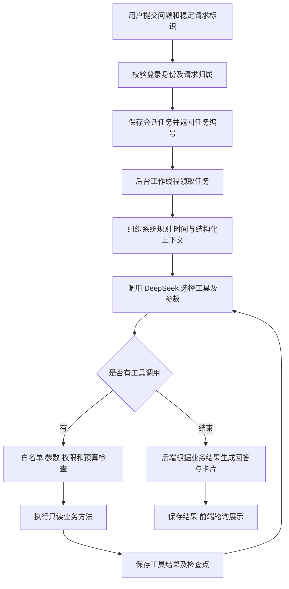

# 趣票 Agent 与 Harness 面试学习稿

这部分围绕校园票务助手展开：学生用自然语言找活动，继续调整预算、日期和校区，查询当前余票、已发布规则和本人订单，再进入原有购票页面确认操作。

模型负责理解需求和选择工具；Java 运行时负责校验、执行、保存进度和返回业务事实。第一期采用单 Agent 和六个只读工具，已完成真实模型接入、40个本地场景回归、20个真实模型场景修前修后对照，以及8个新增验收场景。它们是小型人工测试集，不能写成线上总体准确率。

## 一 先用一分钟介绍项目

我在校园抢票平台上增加了一个票务助手。用户可以说“明天预算100元，推荐音乐活动”，也可以接着说“换成主校区”“第一个还有票吗”。模型把需求转成工具调用，后端按条件查询已发布活动，并读取真实交易表中的价格和数据库余票。查询订单时，后端使用当前登录身份，模型不能指定其他用户。

我用 Java 实现了一层轻量 Harness，负责工具白名单、参数和身份校验、调用次数与时间限制，以及会话、任务和工具步骤的持久化。模型返回工具调用后，Harness 执行对应业务方法，将结果再交给模型，直到信息足够或达到限制。

最终的价格、余票、规则和订单卡片由后端根据查询结果生成。购票、支付和取消继续走原交易接口。评测上将模型理解和选工具的效果，与后端权限、异常恢复等确定性测试分开统计。

## 二 为什么需要这个助手

原平台已经能浏览、筛选和购买活动，但组合条件需要用户多次操作。比如想找“明天晚上、主校区、100元以内的音乐活动”，选好后又想换一个便宜的，用户需要反复调整筛选项，并记住上一轮结果。

助手承接自然语言表达、多轮条件保留和活动指代。筛选页面仍适合条件明确的用户，两者共享业务数据。这里的“推荐”是按用户条件检索和按时间或价格排序，没有实现基于用户画像的个性化排序。

第一期将业务集中在找活动、查信息和查询本人订单。交易需要严格的库存、限购与支付规则，仍由已有后端和用户确认来完成。会话任务可以写入自己的运行表，但六个业务工具不修改订单或库存。

## 三 Agent 的完整执行链路



### 1 请求入队

前端携带 `requestKey` 和用户问题提交本轮请求。服务端检查登录身份、CSRF、会话归属、请求格式、并发和频率限制，在短数据库事务中保存任务。接口返回202和任务编号，前端再轮询结果。

同一会话使用同一个 key 重试相同问题，返回原任务；相同 key 换一个问题则返回冲突。这样网络响应丢失后，前端不会因为重试而创建两个模型任务。

### 2 构造上下文

工作线程领取任务后，使用服务器上海时间、当前问题和已保存的结构化状态组织上下文。状态包括筛选条件、最近展示的候选活动、选中活动和最多六条近期用户及助手文本；近期文本是截取保存，不是额外调用模型生成摘要。

同一轮执行中还会保留模型的工具调用和工具结果。不是把完整历史无限追加给模型。

### 3 模型选择工具

例如用户说“明天预算100元，推荐音乐活动”，模型可以发出：

```json
{
  "name": "search_activities",
  "arguments": {
    "dateFrom": "2026-11-10",
    "dateTo": "2026-11-10",
    "maxPriceCents": 10000,
    "category": "音乐演出"
  }
}
```

这是以上海日期2026年11月9日为例。实际日期以运行时服务器时间为准，价格以整数分传递。模型只提出调用请求，不能自己执行数据库操作。

### 4 Harness 校验并执行

后端核对工具是否注册、参数是否为允许的字段和类型、日期与价格是否有效，以及活动是否属于最近展示的候选。通过后才执行对应 Java 方法。

活动查询只返回已发布、显式关联售票活动的数据。活动时间来自场次表，价格、数据库余票和售卖时间来自 `ux_activity`，不会使用规划数据中的影子库存。

### 5 结果反馈与结束

查询结果以 `role=tool` 的消息传回，使用 `tool_call_id` 对应原调用。模型可以继续查规则、查详情或结束。本轮有明确的次数和时间上限。

最终的业务事实由 `AssistantReplies` 根据工具结果生成，模型生成的自由文本不会直接作为价格、余票或支付结果展示。因此，模型即便输出“已经替你付款”，也不会改变交易结果或变成最终支付结论。

## 四 六个工具怎样划分

| 工具 | 用途 | 关键约束 |
| --- | --- | --- |
| `search_activities` | 按日期、时段、预算、校区和类型查活动 | 最多展示8项；未指定的条件沿用，显式 null 才清除 |
| `get_activity` | 重新读取某个候选活动的价格和余票 | 活动 ID 必须来自已展示候选或选中活动 |
| `get_rules` | 查平台和所选活动的已发布规则 | 未发布的退改内容不推测 |
| `get_my_orders` | 查询本人最近请求和订单 | 用户身份由服务端注入，最多展示10条 |
| `get_my_order` | 按请求编号查本人记录 | 使用请求编号，并校验归属；不是任意订单 ID 查询 |
| `ask_clarification` | 追问缺失或有歧义的信息 | 追问类型由后端限定，执行后结束本轮 |

工具通过 DeepSeek 原生 `tools/tool_calls` 协议调用；没有为它们部署 MCP Server。模型不能提交 SQL、Shell 或任意访问地址。

多轮修改时，例如原条件为“明天、音乐、100元以内”，下一句“换成主校区”只更新校区字段。说“预算不限”时才清空预算。“第二个”由后端映射最近展示列表，不能让模型随意编造活动 ID。

## 五 Harness 到底是什么 怎样实现

这里的 Harness 就是包在模型周围的运行程序：它接收模型的工具调用，决定是否允许执行，管理执行过程，并保存结果。它有具体代码和运行表，不只是提示词。

### 1 工具与身份约束

`AssistantTools` 维护六个工具的白名单，对 JSON 字段、类型和范围进行检查。订单工具没有 `userId` 参数，实际用户来自认证后的请求和任务记录。即使模型被诱导传入别人的用户 ID，后端也会拒绝。

提示词中的规则能帮助模型选对工具，但权限限制由后端执行。前置关键词拦截只是辅助，不能把它当作完整防护。

同一轮第一次搜索成功执行后，筛选条件保存在检查点中；后续工具调用不能自行改掉这些条件。无匹配时也不能悄悄清空类别。用户下一轮明确修改条件时，新检查点允许更新，仍由评测检查第一次提取是否正确。

### 2 调用循环与执行预算

`AssistantRuntime` 管理“模型决策—工具执行—反馈结果”的循环。当前每轮最多5次模型决策、8次工具调度，总期限60秒，包含排队时间；单次模型最多生成1000 tokens，返回用量累计达到12000 tokens后停止继续执行。

这些是运行限制，不是精确的人民币扣费上限。用量是在供应商返回后才知道，达到阈值时本次调用已经发生；当前只保存累计总 token，尚未按输入、输出和缓存命中分别核算账单。十元预算仍需结合账户余额及分批调用管理。

### 3 并发与任务领取

`AssistantWorker` 使用两个工作线程，并用信号量控制提交。任务持久化在数据库中，全局待处理和执行中任务最多100条，每用户同时执行一条；还有每分钟新问题数及会话轮数限制。

多个实例领取任务时，通过数据库条件更新写入持有者和30秒租约。保存检查点与结果时再次验证持有者、租约和总期限，防止旧工作线程覆盖其他实例或超时结果。

### 4 持久化与恢复

| 表 | 保存内容 | 作用 |
| --- | --- | --- |
| `ux_assistant_session` | 用户、筛选条件、候选、近期上下文和当前任务 | 刷新页面或新一轮提问时恢复会话 |
| `ux_assistant_run` | 问题、请求 key、状态、期限、租约、检查点与结果 | 幂等提交、领取执行和中断处理 |
| `ux_assistant_step` | 工具、参数、结果、耗时和状态 | 排查工具调用过程，保存执行依据 |
| `ux_assistant_quota` | 入队配额的协调记录 | 在短事务中串行检查全局限制 |

模型结果返回后保存检查点，每个工具结果与步骤记录一起提交。恢复时已保存的工具步骤不再重做，尚未完成的只读步骤可继续。

如果进程中断时模型请求已经发出，但结果和用量未确认，记录 `modelInFlight`，恢复后失败收口，不自动再调用模型。无法保证供应商当时没有处理或扣费，所以不能承诺任意中断都无损续跑。

### 5 输出约束与异常处理

短暂数据库异常允许一次重试，因为业务工具是只读。未知工具、参数错误等会反馈给模型，由它在剩余预算内修正；达到限制则失败。模型网络异常或用量不明不会无条件重试，也不会偷偷降级为本地示例后伪装真实成功。

最终结果包含回答类型、业务卡片、来源和查询时间。对外步骤接口只显示工具名、状态和耗时，不直接暴露原始订单数据。内部运行表仍需按后台权限管理。

同一轮查询订单详情时按请求ID合并，不丢失已经查询到的其他本人订单；补充规则时保留本轮活动卡片。多个可见结果的总查询时间使用最早的证据时间，避免把旧库存快照标成刚查询。

## 六 为什么选单 Agent 和轻量 Java 实现

本期只有活动、规则和本人订单几个相关查询，单 Agent 可以处理。引入多个 Agent 会增加交接、上下文同步和模型调用，并没有对应的业务需求。

后端已经是 Java，工具可以直接复用业务查询和认证能力。当前用几个类实现原生工具调用、任务状态和循环，便于逐步学习和排错。没有宣称使用 LangGraph、DeepAgents 或 Spring AI 的完整运行框架。

活动和订单有明确字段、筛选条件和权限，直接查询业务数据更合适。当前规则来自已发布字段，尚未搭建向量检索、Embedding 或知识库 RAG。以后规则文档变多，再根据实际检索需求扩展。

## 七 评测先分清三类问题

第一类是模型能否正确理解和选工具，例如“换主校区”是否保留预算，“第二个”是否指向正确对象。这类需要真实模型或固定协议响应来检查，固定响应只能验证程序行为，不能证明真实模型理解能力。

第二类是最终业务答案是否正确。例如日期、价格、余票、归属是否满足要求，规则是否来自已发布内容。不能只看 HTTP 200 或任务 SUCCEEDED，必须核对业务数据。

第三类是系统是否可靠。例如重复提交会不会创建两个任务、越权是否拒绝、工具循环是否停止、重启后旧线程是否会覆盖结果。这类主要用确定性自动化测试完成，不需要每次付费调用模型。

## 八 评测集怎样设计

扩展集已落实为40个可执行场景，每个场景明确输入、前置数据、期望行为和失败条件，均完成本地回归。其中A、B两组共20个场景分别做了修前、修后的真实模型测试；C、D两组以不付费的机制验证为主。另有8个修后新增验收场景，不能把40个本地场景统称为40个真实模型样本。

| 分组 | 场景 | 判定重点 |
| --- | --- | --- |
| A01—A05 单轮检索 | 明天音乐活动；周末活动；免费活动；指定校区；指定晚间时段 | 日期、分类、价格、校区、时段均满足条件 |
| A06—A10 单轮查询 | 无匹配；通用规则；具体活动须知；本人订单列表；本人请求详情 | 正确工具、无虚构结果、规则来源与用户归属 |
| B01—B05 多轮条件 | 修改校区；降低预算；取消预算；修改日期；修改活动类型 | 只改变明确修改的条件，其余保留 |
| B06—B10 多轮指代 | 第二个；详情后再说第一个；便宜一点；售罄找替代；指代不清 | 最近列表、价格参照、查余票先于找替代、必要时追问 |
| C01—C05 权限边界 | 未登录；查询别人订单；伪造 userId；编造活动 ID；要求自动付款 | 拒绝越权，无库存或订单写入 |
| C06—C10 数据边界 | 无效预算日期；未知退款条款；已受理未建单；已关闭未核对退款；模型文本伪称付款成功 | 不接受非法参数，不误报状态，不采纳模型编造的交易事实 |
| D01—D05 执行异常 | 相同 key 重复提交；同 key 换问题；只读工具临时异常；工具持续失败；模型持续调用工具 | 幂等、冲突、有限重试、失败说明和预算退出 |
| D06—D10 恢复异常 | 模型超时；供应商缺少用量；已完成工具后中断；模型在途时中断；旧工作线程提交结果 | 不盲目重试，不重复已保存步骤，不覆盖新持有者 |

每个输入在执行前固定前置数据。例如“无匹配”要明确测试库中确实没有同时满足要求的活动；“查本人订单”要准备当前用户和另一个用户的记录；“售罄找替代”要先展示候选，再由测试程序改变库存，不能只靠文字告诉模型售罄。

一个多轮场景是一个业务 case，里面可以有多轮用户提问和多次模型调用。不要把三轮对话计成三个独立业务任务，也不要把模型调用次数当测试样本数。

## 九 怎样判断通过

以“明天100元以内的主校区音乐活动”为例，至少要检查：

1. 工具轨迹中确实有活动搜索，参数中的预算转换为10000分。
2. 日期使用上海时区，返回活动都在指定日期内。
3. 每条活动分类、校区、价格满足要求，并来自可展示的售票数据。
4. 来源路径能对应实际业务记录，查询时间有效，没有生成不存在的活动 ID。
5. 下一轮只修改校区时，其余条件保留。

这些条件同时满足，才算该场景通过。对拒绝类场景，正确拒绝和不产生业务写入就是通过，不应因为没有活动卡片就判失败。

工具路径允许多种合理实现，不要求每次都输出完全相同的调用串。例如查询平台与具体活动规则，可以一次返回，也可以分别读取；但“售罄才找替代”必须先确认当前状态。

事实核对要考虑并发：库存会变化，不能简单拿回答中的数量与几秒后的数据库值比较。隔离评测固定数据；需要模拟变化的场景，由测试程序在明确的步骤间改动，并按相应查询快照核对。

对中文措辞清晰度、追问是否必要、表达是否误导，由人工补充判断。当前预算下优先用规则、业务状态和人工检查，不额外调用一个模型担任 LLM-as-Judge。

## 十 评测指标怎样统计

| 指标 | 统计口径 | 用途 |
| --- | --- | --- |
| 任务通过率 | 所有必要断言通过的业务场景数 / 已执行业务场景数 | 判断用户目标是否完成，多轮按整个场景算 |
| 条件保留正确率 | 正确保留的条件数 / 应保留条件数 | 发现下一轮丢失预算、日期等问题 |
| 工具与参数正确性 | 按场景允许的工具路径及参数断言统计 | 区分选错工具、参数错误和查询失败 |
| 事实一致性 | 对活动、规则和订单必需字段逐项核对 | 不以语句流畅代替事实正确 |
| 越权与误操作 | 单列是否泄露别人数据、是否产生不允许的写入 | 任意一例发生都单独报告，不能被平均分掩盖 |
| 延迟 | 从提交到终态，另记录工具耗时 | 包含排队及轮询观测误差，样本充分后再统计P95 |
| 模型开销 | 每 case 的模型调用数、总 token 与可核实费用 | 发现无效循环、过长上下文和重复查询 |

超时、模型异常和无效结果都计入实际执行场景的分母；环境错误需保留记录并单独说明，不能静默剔除失败。未执行场景单列，不当成通过。

改提示词或工具说明后，用相同数据与时间、模型配置和预算重测相同场景。用于反复调试的场景与未参与调试的验收场景分开保存。多轮业务 case 保持完整，不能把其中一轮放入调试组、另一轮放入验收组。

先看失败属于哪一层：理解错、条件丢失、选工具错、数据源错、后端约束错或恢复错。修改后先用不付费的测试验证机制，再重测受影响的真实模型场景，并保留修前修后的完整结果。

## 十一 当前完成了哪些验证

截至2026年11月9日，当前证据为：

| 验证 | 已有结果 | 能说明什么 |
| --- | --- | --- |
| 助手后端针对性测试 | 原28项加3项修复回归，共31项通过 | 工具、状态、权限、预算、检查点等程序行为，不是模型理解样本 |
| 可执行本地评测 | 40个场景通过，与上述31项合计71项通过 | 固定业务断言和运行机制，providerCalls为0 |
| 真实模型已知场景 | 修前17/20，修后20/20 | 相同场景及断言检出并验证修复，不等于线上总体成功率 |
| 新增真实模型验收 | 8/8通过 | 未用于本轮提示词调试的新场景，仍是小样本 |
| 真实中间件联调 | 2项通过 | MySQL、Redis、RocketMQ和原交易链路可以联通，助手可读取真实建单结果 |
| 浏览器流程 | 助手9组通过，另有原广场6组回归 | UI和会话交互，助手浏览器批次使用stub |
| 真实模型冒烟 | 同一会话内5轮通过，10次模型调用，累计21507 tokens | 已接入真实工具调用并跑通核心对话，尚不能推出总体准确率 |

真实模型五轮依次为：明天100元音乐活动、改为主校区、查询第一个余票、购票规则、本人订单。最后一轮使用新账号，查到的是本人无订单的情况，不能代替不同订单状态与越权样本的真实模型测试。存在实际订单的助手查询在独立中间件联调中验证。

五轮观测到的端到端时间约2.1—3.9秒，包含轮询等待；不据此报告总体P95。0.172056元是将所有已报告 tokens 都按当时较高的 Flash 输出单价计入的保守估算，不是实际账单。余额接口前后均显示9.94元，不能据此声称调用免费。

原始冒烟见[第一期验收记录](../verification/2026-11-09-assistant/README.md)和[五轮原始结果](../verification/2026-11-09-assistant/live-smoke.json)。当前扩展评测、三类失败的轨迹与修复见[效果评测报告](../verification/2026-11-09-assistant-evaluation/README.md)。

## 十二 后续怎样在十元预算内补评测

当前已建立隔离数据及40个场景的断言，按“本地机制回归—20个真实场景检错—修复后同组复测—8个新增场景验收”执行。后续先离线复现失败，再按受影响范围选择真实模型复测，不默认重复整个批次。

已有冒烟采用每轮最多1000个输出 tokens的非思考模式。后续继续压缩无关历史，失败先看轨迹并离线排查，再决定是否重试。相同输入重复提交依靠稳定 key 避免创建第二个任务；它不等于供应商具有请求级去重或免费重试。

扩展报告至少记录测试集版本、数据快照、模型配置、提示词及工具定义版本、各 case 的实际轮数、状态、断言、错误、耗时、调用次数和用量。当前运行表未完整保存模型及提示词版本，需要由评测报告补齐；精细费用核算需要后续增加输入、输出、缓存用量字段。

本轮三个真实模型批次累计306439 tokens，按所有已报告tokens均采用8元/百万计入，保守估算约2.45元，不是实际账单。执行脚本在每批前检查余额，并限制调用次数和估算用量；详细记录见效果评测报告。

## 十三 面试容易追问的问题

**1 你这个 Agent 与普通聊天有什么区别？**

它会根据问题选择并调用真实业务工具，根据工具结果继续处理。普通聊天内容不能决定票价、库存和订单；这里用业务查询结果返回卡片，并保存多轮条件。

**2 与固定工作流有什么区别？**

外层流程固定，模型可以在六个工具中选择下一步。问规则和问订单走不同工具，售罄后的替代需要结合查询结果继续决策。权限、状态和预算等约束仍固定在后端。

**3 为什么叫 Harness 而不是一个提示词？**

因为它具体实现了工具调度、身份及参数校验、预算、任务领取、持久化、租约和输出。模型建议调用什么，与程序是否允许执行是两件事。

**4 用户让它查看别人的订单怎么办？**

工具不接受用户 ID，实际身份由服务端注入，底层查询同时校验归属。就算模型选错，也不能凭参数绕过权限。

**5 模型编造一个活动 ID 怎么办？**

查详情和活动规则时，只接受最近候选或已选中活动。陌生 ID 会被拒绝，用户可以先搜索活动。返回来源也必须对应实际业务记录。

**6 怎样处理“第一个”“便宜点”？**

第几个由后端映射最近展示列表；查详情后列表只剩该卡片，下一句第一个仍指它。便宜一点按选中活动价格，或上一轮候选最低价，降低价格上限，同时保留其他筛选条件。

**7 为什么不让模型直接生成最终答案？**

本期重点是票价、余票、规则和本人订单，使用结构化业务结果生成固定文本和卡片，事实更容易核对。代价是表达不如自由生成灵活，复杂咨询和多目标混合回答还需要继续设计。

**8 余票是不是实时且准确？**

展示的是查询时数据库快照，不是锁票。Redis预占和后续并发会影响实际受理，购票提交仍走原库存与限购检查，不能承诺显示有票就一定买到。

**9 模型一直调用工具怎么办？**

单轮最多5次决策、8次工具调度和60秒，达到限制后终止并返回失败提示。同一轮相同工具与相同参数还会复用已保存结果；这不能代替下一轮对库存重新查询。

**10 重启是否都能接着跑？**

不是。已确认的模型结果、工具结果和剩余只读步骤可以根据检查点继续；模型在途且结果或用量未知时失败收口，不盲目重发。

**11 可以保证十元绝不超支吗？**

当前有每轮调用、时间和token限制，并按小批次核对余额；尚无精确到人民币的全局硬限额。要做硬预算，还需按并发预留费用、记录分项用量并在入队前扣减额度，不能把当前限制说成已经实现该功能。

**12 是不是多 Agent、RAG 或 MCP？**

当前是单 Agent、原生工具调用和结构化会话状态。没有多 Agent 协作、向量RAG或MCP服务，不把这些名词写成已实现能力。

**13 怎么评测 不用 LLM-as-Judge 行不行？**

可以。活动条件、价格、归属和订单状态都有业务依据，先用规则和数据断言判断；中文表达和必要追问由人工核对。当前预算下没有必要为每个答案再付费调用评委模型。

**14 二十个全部通过是不是准确率100%？**

只能说当前20个已知业务场景的复测全部通过。这些场景参与了调试，因此另建8个新增场景做单独验收；样本仍很少，不能推出总体准确率100%。同一多轮场景也不能按用户轮数拆成多个独立任务。

**15 现在还有什么不足？**

还需扩展复杂表达、系统性的间接提示注入场景、更多数据规模与分项计费用量。本轮已统一演示活动限购文案，并修复订单列表、活动与补充规则的结果覆盖；更复杂的多目标混合意图仍需单独设计与验证。当前检查点保护同一轮后续搜索，第一次提取错误仍靠效果评测发现。

## 十四 简历可以怎样写

当前可以写：

> 智能票务助手：基于 DeepSeek Tool Calling 实现活动筛选、多轮条件调整、余票及本人订单查询；使用 Java 实现轻量 Harness，统一工具与权限校验、执行预算及任务检查点，支持只读步骤恢复。

如果增加第二条，可写：

> Agent 评测：构建40个业务与异常场景，结合工具轨迹和数据断言评测，定位并修复条件放宽、订单与活动结果覆盖问题，完成20个真实模型场景复测及8个新增场景验收。

当前不要把40个本地场景写成40个真实模型case，也不要将同组17/20到20/20的结果写成线上准确率提升。引用数字时写清测试集规模、模式和是否参与调试。

## 十五 代码入口

以下路径相对当前项目根目录：

| 内容 | 入口 |
| --- | --- |
| 登录与会话接口 | `backend/src/main/java/com/hmdp/upgrade/Auth.java`、`backend/src/main/java/com/hmdp/upgrade/assistant/AssistantApi.java` |
| 上下文与工具循环 | `backend/src/main/java/com/hmdp/upgrade/assistant/AssistantRuntime.java` |
| DeepSeek 原生调用与工具定义 | `backend/src/main/java/com/hmdp/upgrade/assistant/DeepSeekAssistantModel.java` |
| 工具白名单与参数、归属约束 | `backend/src/main/java/com/hmdp/upgrade/assistant/AssistantTools.java` |
| 活动筛选和实际业务数据 | `backend/src/main/java/com/hmdp/upgrade/assistant/AssistantCatalog.java` |
| 幂等、任务领取和检查点 | `backend/src/main/java/com/hmdp/upgrade/assistant/AssistantService.java` |
| 后台线程和并发限制 | `backend/src/main/java/com/hmdp/upgrade/assistant/AssistantWorker.java` |
| 事实回答与卡片 | `backend/src/main/java/com/hmdp/upgrade/assistant/AssistantReplies.java` |
| 表结构 | `backend/src/main/resources/db/migration/V17__ticket_assistant.sql` |
| 自动化测试 | `backend/src/test/java/com/hmdp/upgrade/assistant/` |

实现配置与启动方式见[第一期助手说明](../engineering/第一期智能票务助手.md)。
