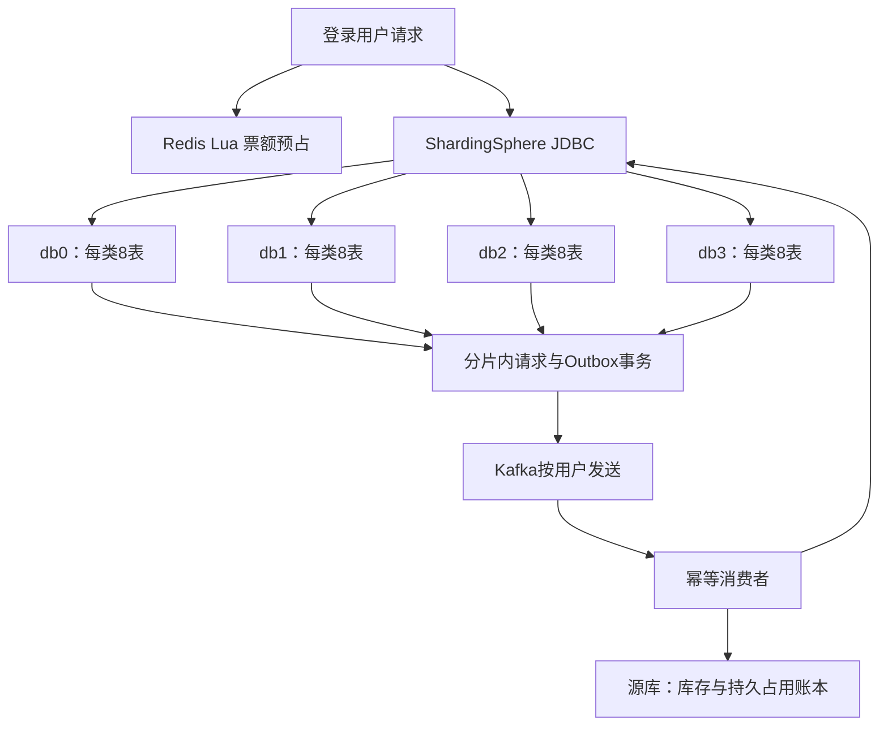

# 趣票核心业务分库分表：按参考文档学习

2026-10-29 更新：消息链路已改为 RocketMQ 异步建单与延迟关单。下文 Kafka、Redis 关单 ZSet 的说明属于此前实现；数据库结构、库存与支付并发设计仍可参考，消息部分以[RocketMQ 改造说明](../engineering/RocketMQ迁移与验收.md)为准。

本篇对应用户提供的[原始文档](../reference/分库分表用户参考原文.txt)，沿用其章节顺序。它说明新的 CORE32 主交易模式；此前双查询库、32表是历史读模型实验，不能作为本篇实现或性能证明。验收见[本轮记录](../verification/2026-10-27-core32/README.md)。

针对当前简历的库表结构、字段关系、设计原因和逐题回答，另见[订单分库分表详细面试稿](../interview/06-订单分库分表-库表设计与面试详解.md)，附一分钟与两分钟口述版本。

新增[五项目标量化复核](../verification/2026-10-27-core32-capacity/README.md)：百万合成主订单每片31,250条，连接承载和单分库导出恢复已验证；同机等资源下，当前CORE32的查询/写入吞吐尚未高于单库。功能正确性、数据布局和性能目标要分别说明。

## 为什么需要分库分表

趣票是校园活动与抢票项目，目前真实数据量较小。我们以订单持续累积、多用户集中下单为演进场景，主动实现和验证分片能力，没有“线上几千万订单把数据库打满”的实际经历。

| 原文提出的问题 | 本项目针对的部分 | 仍然存在的约束 |
|---|---|---|
| 连接数与并发瓶颈 | 用户交易读写使用4个独立实例的连接池 | 每应用实例每目标库最多6连接，目录库最多12；实例增加会叠加连接，不能无限扩池 |
| 单表膨胀 | 每类用户交易表按32个分片存放 | 查询计划、索引、行宽、硬件决定性能，几百万行不是统一失效阈值 |
| 写入热点 | 不同用户的主订单、请求、Outbox分散写入 | 单个热门活动的权威库存锁仍集中；分片不消除同一活动的锁竞争 |
| 容量与故障影响 | 用户交易数据分散，运行中单个目标库故障可限制到部分用户 | 目录、鉴权、库存仍依赖源实例；没有主从自动切换，冷启动仍需四库元数据 |
| 扩展成本 | 提供多个独立实例承载用户交易的结构 | 固定32片改变时需要迁移，不支持任意在线自动扩容 |

合适的面试动机：**为订单增长和多用户并发预先验证水平拆分，重点完成路由、跨库一致性和可控迁移。** 不把架构演练说成已经解决线上容量事故。

## 分库分表能带来什么

把高增长用户交易数据从单实例移到4个实例，降低每张表承担的数据量，允许不同分片并行读写。是否更快需要同条件实测，不能用“32 × 500万 = 1.6亿”宣称容量。旧读模型的百万行JDBC对照也不能作为本轮主订单容量证据。

## 什么是分库分表；拆分方式有什么

- 垂直分库按业务职责分开；本项目区分源目录/活动库存与用户交易分片。
- 垂直分表按字段拆，原文将其放在“垂直分库”下，学习时应区分。
- 水平分库把同一逻辑表的不同行分布到不同实例；水平分表在各实例再拆物理表。

不是把所有业务各自建一个库，再强行跨库关联。本项目让同用户的请求、订单、支付、任务尽量共置。

## 路由过程

```text
shard = user_id % 32
dbIndex = shard / 8     // 整数除法
tableIndex = shard % 8

10086 % 32 = 6 → db0.cx_order_6
31 % 32 = 31 → db3.cx_order_7
```

数据库索引0–3；每库表后缀0–7。**不是每库32张主订单表，也不是四个schema共用一个mysqld。** 本机四个目标实例端口33400–33403，server_uuid不同。

## 常见组件及本项目选型

使用 ShardingSphere-JDBC 5.5.2，嵌入 Java 后端，提供逻辑表路由、绑定关系、广播和SQL审计。没有额外代理服务。Proxy适合多语言统一接入，这里没有引入它的必要。新增代码由 Maven `sharding` profile 编译，默认旧模式仍可构建。

## 一、总体架构



逻辑表访问隐藏物理库表位置，但不能隐藏跨库事务边界。新模式的库存与订单已不属于同一个本地事务。

## 二、表拆分规划

| 类型 | 实际表 | 规则与用途 |
|---|---|---|
| 用户分片/绑定家族 | cx_user、cx_request、cx_order | user_id，同用户业务档案、请求和权威订单共置 |
| 用户分片/绑定家族 | cx_outbox、cx_action、cx_close | user_id，与业务状态在分片内提交可靠任务 |
| 用户分片/绑定家族 | cx_payment、cx_receipt、cx_refund | user_id，支付状态与订单协调 |
| 独立分片 | cx_check_log | 按order_id字符串哈希分32片；通过可重试动作记录事件，不参与订单本地事务 |
| 广播 | cx_event | 小型活动展示快照：名称、票档、价格展示、起止时间等 |
| 源库保留 | ux_account、会话、活动与库存 | 登录凭据、用户名全局唯一性与库存权威裁决 |
| 源库保留 | ux_core_stock_hold、ux_core_order_route、渠道占用/退款账本 | 跨库幂等、订单定位及模拟渠道去重 |
| 源库保留 | ux_waitlist、迁移日志、worker租约 | 活动级候补队列、迁移与ID协调 |

cx_user是用户业务档案，**没有把登录密码和全局用户名唯一约束一起分片**。源库目录、库存占用和定位表仍会增长，是后续需要治理的部分。

项目没有签到业务，不添加虚构的tb_user_sign。原文的tb_seckill_voucher若包括动态库存，不能作为各库都可独立修改的广播表。这里仅广播展示配置，成交金额使用库存裁决保存的权威快照。

广播更新不构成跨四库原子事务；中途失败由定时重试覆盖。展示可以短暂滞后，不用于票额裁决。

绑定关系只保证一致的路由布局，SQL仍需带分片键并使用用户关联条件。

## 三、分片策略

用户维度精确读写是主要访问路径，因此使用user_id取模。按时间Range分片有利于归档，但会把当前写入集中到最新区间，也会拆散一个用户的订单。固定32片下先采用简单取模；一致性哈希虽然减少部分迁移，也不能自动解决数据库扩容、数据搬迁和切换一致性。

散列用户不保证绝对均匀，单个大用户仍可能形成热点。当前没有在线从32改64的能力。

## 四、全局ID与路由协同

新增用户、请求、订单和任务使用 Snowflake：41位相对毫秒时间、10位worker、12位序号，起点2026-01-01。数据库里的既有UUID订单迁移时保留。

worker由源库持久租约分配，30秒租期、10秒续租，本地20秒失去续租即停止发号，同时记录时间上界，避免崩溃后过早复用同worker。时钟回拨、序号耗尽或租约失效返回可重试失败，不冒险重复发号。单worker同毫秒最多4096个序号，启用随机起点后实际剩余数量略少。

**与取模路由的一个细节：** 每毫秒序号若总从0开始，低频注册的用户ID低位总为0，user_id%32会形成热点。因此新毫秒从0–31的随机序号起步，再在毫秒内递增。趋势递增与全局唯一性仍由时间、worker和序号共同保证，随机起点不替代worker租约。

响应中的用户和订单ID使用字符串，避免JavaScript超过53位整数后损失精度。Snowflake不是分库分表唯一ID方案；原UUID同样可保持唯一，此次选择雪花主要用于统一新增ID并保留趋势性。

## 五、查询与索引策略

用户ID取自服务端登录身份，不信任客户端指定的userId。常用SQL形如：

```sql
SELECT r.*, o.state
FROM cx_request r
LEFT JOIN cx_order o ON o.user_id=r.user_id AND o.request_id=r.id
WHERE r.user_id=? AND r.id=?;
```

绑定表路由到同一库表，cx_event在目标库本地关联。请求键唯一约束为(user_id,request_key)，订单限制为(user_id,activity_id)。历史查询直接读取权威cx_order，不经过此前历史投影。

启用`DML_SHARDING_CONDITIONS`审计拒绝逻辑分片表无分片键查询。定时任务、校验和运维需要遍历时显式访问32个物理分片并限批，不将它作为用户请求的通用查询路径。

只有订单号时，先查源库`ux_core_order_route`拿user_id，再查询目标订单。定位目录由订单事务内动作异步写入，存在短暂未就绪窗口；返回未就绪/缺失，不退化成无界全路由。核对事件按订单号哈希独立定位。没有实现ES、数仓和管理端任意多条件检索，不照抄成已有能力。

## 六、引入后代码怎么改

### 6.1 抢票写入与库存一致性

1. Redis Lua过滤售罄和一人一票档，按请求键预占；此时不代表订单已成功。
2. 一个用户分片本地事务写cx_request与cx_outbox，再返回202。相同用户+请求键重放返回同一请求。
3. Outbox有租约、发送重试及发送后标记；Kafka按用户键发送，消费者验证用户与活动。
4. 消费者锁分片请求，在源库事务中按request_id取得持久库存占用：活动行锁、条件减库存、唯一占用记录同事务提交。
5. 在用户分片事务内插入订单、请求终态、关单任务及后续动作。重复消费只读取已完成状态，不再次扣库存或建单。
6. 取消、拒绝和到期在分片内产生持久动作；源库存占用HELD→RELEASED的条件更新保证只加回一次，再幂等更新Redis。

跨库故障窗口必须会解释：

| 故障点 | 保留的证据 | 恢复方式 |
|---|---|---|
| Redis已预占，请求未提交 | Redis pending与请求键 | 超时扫描，在用户锁下写过期围栏，再释放预占 |
| 请求已提交，Kafka未发出/发送结果未知 | 分片Outbox | 重试发送，允许重复；消费者幂等 |
| 源库存已提交，分片订单未提交 | 源占用HELD，分片请求ACCEPTED | 重放复用原占用；期限后请求终态通过补偿释放 |
| 分片订单已提交，消息未确认 | 请求终态与唯一订单 | 重复消费不再扣库建单 |
| 取消已提交，回补未完成 | 分片动作与源占用状态 | 重试，源CAS与Redis幂等各自防重复 |

**不能在源库存提交结果未知时立即盲目加库存，也不能仅凭占用超时就释放一个可能已提交的订单。** 必须依据分片请求/订单终态补偿。允许短暂少卖，不允许通过猜测制造超卖。

### 6.2 用户查询、支付与关单

请求、订单、支付和close任务按用户共置。支付与关单锁同一请求，订单通过PENDING_CONFIRM条件更新落终态。Redis ZSet负责快速到期触发，分片持久close扫描兜底；本机按五分钟自然到期验收。

渠道通知先在源库登记全局channel占用，再在用户分片提交支付流水；登记后进程崩溃由后台继续处理。关单后到账生成退款任务；模拟渠道退款账本按channel去重，退款成功但确认丢失时重试不会再次退款。这里只是模拟渠道。

候补队列仍在源库按活动扫描，补位调用同一分片抢票入口；不保证严格FIFO。

### 6.3 管理查询与恢复

`/v2/admin/core32`给出四个实例身份、订单数量、错片数量、库存/状态不变量及请求、Outbox、动作、退款和到期任务积压。管理员订单号查询走定位目录。全局状态接口需要所有目标库可访问，不作为单分片存活探针。

Redis数据丢失需要维护恢复：停止写入及工作线程，设置PAUSED，依据全部目标请求/订单和源占用重建Redis，再更新epoch；中途失败留恢复未完成标记，禁止直接恢复CORE。当前单活动恢复限1万请求，超出会拒绝，尚无大规模分批快照恢复。

## 七、迁移、校验、切换与回退

原文说“双写+灰度”，实际不能理解为业务线程依次写两个库就万无一失。本项目实现的是**源事务日志驱动的异步镜像、维护停写切换**，没有宣称零停机在线灰度。

1. 源库V15触发器在原写入事务内标记用户revision；回填与变更共用这个持久用户日志。
2. 每用户读取源库一致性快照，分片事务复制业务家族，copy_revision防旧任务覆盖新快照；持久租约和applied_revision支持崩溃后继续。
3. 迁移期间仍以旧交易为权威。停旧接口和后台写入、等待在途事务结束，设置PAUSED，追平剩余日志。
4. 核对关键字段、每用户行集、全局物理行数和错片；不只比总数。通过后重建预占索引，记录activated，启动CORE写入。
5. 切换后源库不再保存新主订单。**回退前必须停新写入、清理ACCEPTED和未处理渠道通知，反向复制分片最新数据到源库，核对并重建旧Redis，再启动旧交易。**

只切一个开关会丢掉新模式订单。四个目标主库有不可读数据时也不能靠旧源库无损回退，必须先恢复目标数据。模式入口检查不替代停止在途事务的运维步骤。

当前按用户快照每家族限1万行，没有删除业务镜像、超大用户分页迁移、自动在线扩容、主从容灾或自动灰度。它们不写成已实现能力。

## 本机运行与复现

已配置的本机环境：源实例33307；目标33400–33403；Redis36380的DB11；Kafka39093；后端38193。直接集成测试使用独立verification schema与Redis DB12，旧链路回归用另建schema与DB13。Redis本机连接超时5秒、命令超时1秒；未改缓存算法。密码只在被忽略的`.local`配置中。

已有源实例和本机凭据后，在项目根目录执行：

```powershell
./backend/scripts/core32-local.ps1 init
# Java17 / Maven3.9.9 下先执行：mvn -Psharding -DskipTests package（backend目录）
./backend/scripts/core32-local.ps1 maintain -Command init
./backend/scripts/core32-local.ps1 maintain -Command status
./backend/scripts/core32-local.ps1 test
```

空环境首次启用或完成维护迁移后：

```powershell
# 有旧业务时先停旧写入，并按前述begin/copy/verify步骤迁移。
./backend/scripts/core32-local.ps1 maintain -Command activate
./backend/scripts/core32-local.ps1 run
```

迁移CLI支持begin、copy、verify、activate、pause、recover、rollback。需要停新进程时使用halt；回退按“先PAUSED、halt、确认已排空、rollback、再启动旧模式”的维护顺序。CLI与新进程不应同时执行切换或恢复。

`node backend/scripts/core32-http.mjs`会新增独立演示数据并注入进程、中间件故障；运行前单独以`run -EnableFaults`启动，且不要并行压测或运行共享组件回归。正常演示不启用故障开关。MySQL/Kafka/Redis安装路径可由本机脚本参数调整；本次没有运行容器组合或真实支付。

### 后续迁移是否需要重新造数据

不需要。应保留源目录库和四个主交易库的完整备份，而非只复制DDL或原来的单库。Redis可在维护模式按账本恢复；Kafka未处理工作和分片Outbox也需按迁移窗口核对。

本机原生MySQL数据目录为了避开中文安装路径位于系统临时目录的`qupiao-core32-<项目摘要>`下，不适合长期只依赖该位置。已在服务停止、源模式PAUSED时把目录库和四个目标库导出到被忽略的`.local/core32/backups/20261027-163213`，包含5份SQL及大小、SHA256清单；内含账户数据，不提交仓库。这里只验证导出成功，未宣称跨机器恢复演练已完成。之后有新交易需重新备份，旧快照不会自动更新。

跨机器搬迁时维护停写、导出同一静止时间点的五个库，在目标MySQL恢复后配置URL和账户，保持PAUSED核对主数据与库存，再恢复预占索引并启用CORE。分别在持续写入时执行五次single-transaction导出不构成跨库同一快照。

## 面试背诵版本

趣票原先把交易数据集中在一个MySQL实例。考虑订单持续增长和多用户集中抢票，我按参考方案实现了ShardingSphere-JDBC的4库8表，把主订单及请求、支付和任务按user_id共置。取模先算32片，再确定库和表，用户查询带登录身份的分片键，绑定表关联在同一分片完成，只有小型展示配置广播。只有订单号时通过定位目录拿user_id，避免全路由。

难点在库存和订单跨库后不能再依赖一个本地事务。我保留源库库存裁决，用持久库存占用保证预扣可重放，分片内提交请求、Outbox和订单任务，靠Kafka重试和幂等补偿处理崩溃窗口。支付和关单仍在同用户分片协调，回补及退款各有幂等账本。

新增ID用带worker租约的Snowflake，处理时钟回拨和低位取模热点。迁移通过源事务日志驱动异步镜像，支持版本防倒退和断点继续；维护停写、字段核对通过后切换。回退要把切换后的主数据反向复制，不能只切开关。本项目是小规模真实链路与故障演练，没有声称线上海量容量、固定性能收益或自动容灾。
