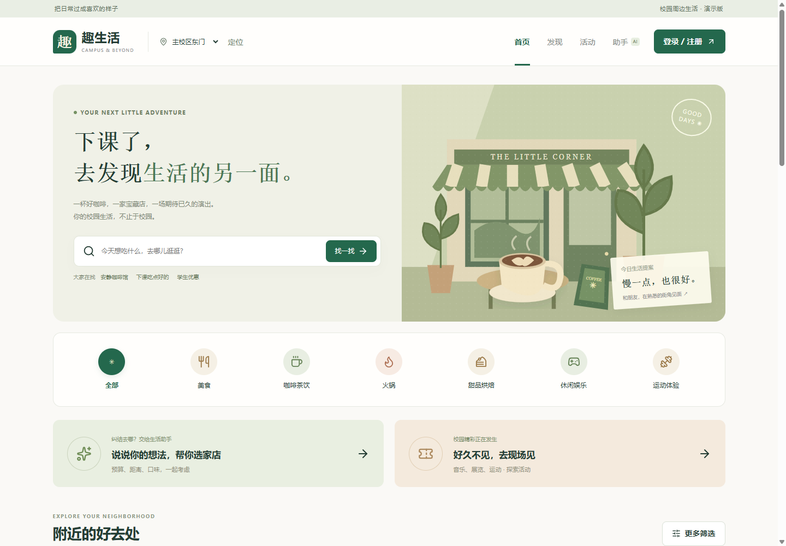
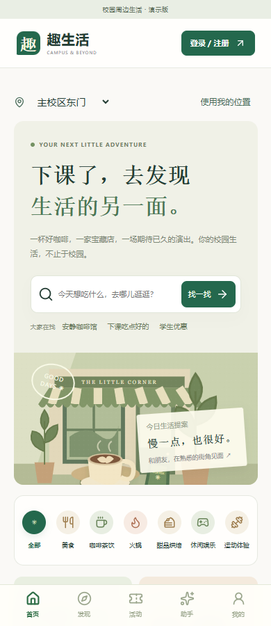

# 2026-11-19 趣生活首版验证记录

对应 [PRD](../../product/校园周边生活平台-PRD.md) 和 [独立评审](../../product/校园周边生活平台-PRD评审.md)。评审首轮 88 分且不通过，修正核销/作废竞争、密码重置与登录竞争等设计后，复评 **94 分通过**，随后开始开发。

## 本轮交付

新模块为单库校园周边生活平台：账号资料与恢复、真实商铺查询、免费券领取/核销、评价/点赞/举报、签到/打卡、服务端收藏、运营后台、选店/客服工具与响应式前端。原有 RocketMQ 票务、模拟支付、延迟关单和补偿保留。

30 家新商铺、6 类业态、3 个校区、4 个商圈、6 个地标；180 条标注为演示的评价；30 条规则；当日 20 个券模板含暂停、结束、未开始和已领完案例。新图库 76 幅原创 SVG 示意图，包含 30 封面、30 店内、15 菜单/细节及 1 张首页插画。来源见 [素材清单](../../../frontend/public/local-assets/manifest.json)。不使用爬取的大众点评商户、用户评价或图片。

## 自动化结果

| 验证 | 实际结果 | 环境与范围 |
| --- | --- | --- |
| 默认后端完整回归 | 315 项，255 通过、60 跳过、0 失败/错误 | Java 17、Maven 3.9.9；跳过项为需专项中间件/多库环境的用例 |
| 新模块最终定向回归 | 80 项通过、0 跳过/失败 | 真实 H2 SQL、事务与约束；不是把数据库调用全部 mock 掉 |
| Agent 分组验收 | 60 项通过、0 跳过/失败 | 固定 20 选店、15 客服规则、10 本人数据/越权、10 多轮歧义、5 失败恢复；stub + 真实领域读取 |
| 真实集成测试 | 5 项通过、0 跳过/失败 | MySQL 8.0、Redis 3.2、RocketMQ 5.3.2、真实 HTTP、独立 verify 库 |
| 浏览器 | 19 项通过、无未捕获运行错误 | 专用 Chrome 隔离 context，2 个普通测试账号、1 个运营账号 |
| 生产构建 | 前端和后端成功 | 默认 Maven 构建，不要求开启 sharding；前端 Vite 构建 |

这些测试集合有重叠，不能把它们相加当作互不重复的测试总数。此前还运行了 sharding profile 回归（342 项、253 通过、89 环境跳过），最终普通模块验收以默认构建和本轮定向结果为准。

新模块的 80 项中包括 54 个类别/校区/预算组合、6 个工具身份注入拒绝用例，以及 20 项业务/安全用例。覆盖 100 用户竞争 20 张券、重复领取、核销与作废竞争、操作键重试、失效券、规则快照、媒体发布与隐藏、评价版本、点赞/签到、跨年连续签到、私有数据、恢复码单次使用，以及可控的“旧密码校验通过后再发生密码重置”竞争。

真实集成的 2 项原助手测试确认真实 RocketMQ 消费建单和持久化多轮查询；3 项新模块测试检查实际 MySQL V18 迁移、角色/CSRF、商铺版本、券核销幂等、跨账号隔离和 multipart 图片权限。

[浏览器原始报告](browser-results.json) 包含每项结果。页面覆盖：注册、收藏、领券/券包、评价编辑、另一账号点赞、签到/打卡、改密恢复、选店/比较、本人券包、运营拒绝/允许、抢票/模拟支付、核销、新建商铺。额外模拟了图片加载失败和商铺接口中断，验证占位图、错误提示和恢复重试。

## 本机性能抽测

Intel Core 7 240H、16 逻辑核、32 GiB 内存，服务和请求端同机；30 多家演示/验收商铺，数据量很小。直接访问 Spring Boot HTTP，未经过真实公网、TLS 或生产网关。

| 场景 | 并发/速率 | 时长 | 请求数 | P95 | 结果 |
| --- | --- | --- | --- | --- | --- |
| 公共商铺列表与详情交替读取 | 20 并发、闭环持续请求 | 60 秒 | 125,716 | 34.89 ms | 全部 200，约 2,095 成功请求/秒 |
| 同账号重复签到/收藏 | 20 工作线程，每线程间隔 667 ms，合计约 30 次/秒 | 60.54 秒 | 1,800 | 12.24 ms | 全部 200 |

写操作另做了不节流测试：170,460 请求中 6,100 成功、164,360 返回 429。它说明入口拒绝了超限流量，**不能把这组包含大量拒绝的低延迟当成业务处理能力**。正常写入抽测因此另行控速，详见 [正常负载结果](load-results.json)、[超限结果](overload-results.json) 和 [可复跑脚本](../../../frontend/tests/local-life-load.mjs)。

SQL 次数未单独采集；签到和收藏写测是同账号的幂等重复路径，不代表全新领券的吞吐。未执行生产容量评估，也未把原简历中的旧缓存 A/B 数字移作新平台结论。

## 页面检查

已检查桌面 1440 px，以及手机/平板 360、390、768 px。三个移动宽度首页无横向溢出；商铺详情、券包、个人中心、评价、助手、运营核销和模拟支付另有运行截图。

| 桌面首页 | 手机首页 |
| --- | --- |
|  |  |

其他截图：[商铺详情](shop-1440.png)、[手机商铺](shop-390.png)、[个人中心](account-390.png)、[券包](wallet-1440.png)、[评价](reviews-390.png)、[助手](assistant-1440.png)、[手机助手](assistant-390.png)、[模拟支付](ticket-payment-1440.png)、[运营核销](operator-1440.png)。

截图来自独立验收库，包含测试增加的商铺和评价；新建普通演示库使用未被测试消耗的初始数据。截图和报告不包含演示账号密码、恢复码或核销码。

## 验收中的修正

- 新店 Bloom 登记移入创建事务，避免新店种子/运营创建失败。
- 请求取消时不再把未读取完的响应当成空对象，避免页面访问不存在的数据。
- 改密与登录共用账号行锁，旧密码校验后发生重置的登录不能创建新会话。
- 页面订单查询持续更新待处理结果；修正活动页的 history 变量遮蔽。
- 运营核销和作废在发送前保存完整操作键及参数，结果不明时复用；明确的 4xx 失败允许重新操作。
- 手机端提供地标及主动定位，图片失败有占位，接口失败可重试。
- 图片解码每实例最多并行 2 个，配合文件、像素、频率和容量限制。
- 助手反馈草稿保存 draftId，刷新后确认仍复用同一幂等标识；已下架候选不继续作为可比较店铺。

## 明确的未验证范围

1. **真实大模型效果**：未配置/调用模型密钥，未执行 PRD 的真实模型开发集与盲测集。当前完成工具契约、权限、确定性多轮演示及业务链路；80 项组件用例及 60 项分组验收不等于自然语言真实模型质量评测。
2. **G05 的确定性部分已完成**：[60 例逐项记录](agent-corpus.json) 保存输入、固定数据、预期工具、业务约束与结果；它与 80 项组件回归分开统计，不代表真实模型自然语言质量。
3. **新模块 CORE32**：未适配；与新模块同时开启会拒绝启动，避免误用跨库业务。
4. **正式支付/短信/地图/对象存储及公网部署**：均不在首版范围。Docker 配置已补媒体卷和功能开关，本轮未运行容器部署验收。
5. **全量故障注入与大数据压测**：保留原专项测试，本轮普通回归中相关环境用例有跳过，不宣称重新完成了全部多库、故障演练和高并发交易容量测试。

运行方法和配置见 [运行与实现](../../engineering/校园周边生活平台-运行与实现.md)。
