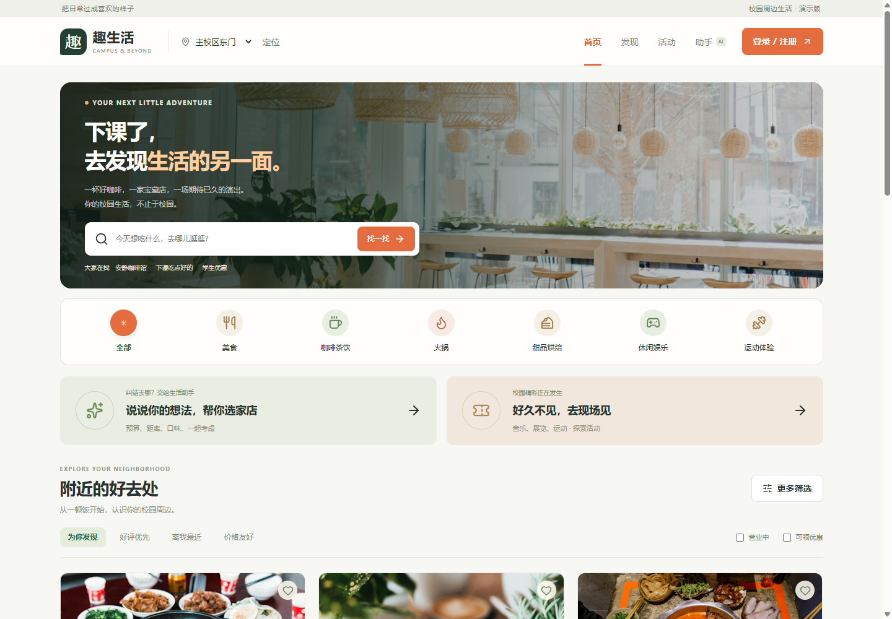
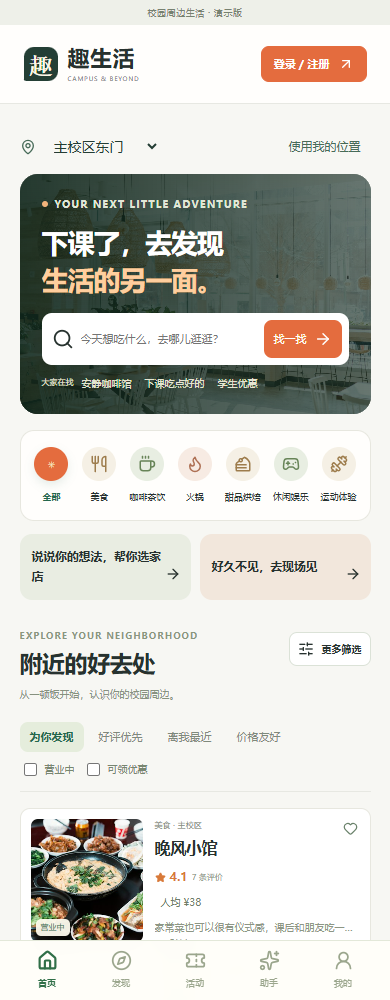

# 真实摄影与个性化助手验收 · 2026-11-20

本轮按用户要求替换插画、优化排版，并完善多轮对话、用户偏好、商家推荐与客服。实现及使用方法见 [升级说明](../../engineering/真实照片与个性化生活助手.md)。

## 照片和界面

- 47 张不同的真实授权摄影，30 家商铺使用不同封面；每店3张场景相册，首页摄影横幅。
- 原图及预览图均在项目内提供，包含作者、来源页和许可。`manifest.json` 中的文件 SHA-256 已逐项校验，全部 JPEG 可解码；下载后检查了联系表和实际页面。
- 47 张1280px详情图合计约11.56 MiB；480px预览图合计约2.18 MiB，平均47.5 KiB。这里比较的是素材体积，不据此声称接口性能或页面速度提升固定倍数。
- 桌面1440px、手机360/390px、平板768px检查；首页无横向溢出。比较表在自身区域滚动，不撑宽手机页面。
- 照片只是虚构商铺的场景配图，页面保留演示说明。未把网上餐馆照片冒充为这些店的现场实拍。

[照片与作者清单](../../../frontend/public/local-photos/manifest.json)，许可见 [Unsplash License](https://unsplash.com/license)。

## 实际测试结果

| 项目 | 结果 | 说明 |
| --- | --- | --- |
| 全部后端默认回归 | 387 项：327通过，60环境跳过，0失败/错误 | 包含此前60例Agent分组测试；不是生产容量或真实模型评分 |
| 最终偏好/客服定向验证 | 13项通过 | SQL事务、版本冲突、身份隔离、偏好应用/清空、总预算追问、组合证据、工具约束 |
| 真实中间件 HTTP 集成 | 5项通过 | MySQL20次迁移、Redis、RocketMQ、实际HTTP及multipart上传；沿用并复验既有交易与核销用例 |
| 原业务浏览器回归 | 19项通过 | 注册、签到、收藏、券包、评价/点赞、打卡、找店、模拟支付、运营核销/新建商铺、图片与网络失败恢复 |
| 新照片/个性化浏览器 | 9项通过 | 真实照片、偏好UI、多轮条件、比较表、换一批、客服规则、偏好确认、新会话/预算追问、账号隔离 |
| 前后端生产构建 | 成功 | Java17、Maven3.9.9、Node24、Vite；锁定现有依赖 |

上述集合存在重叠，不能加总为互不重复的测试数。完整回归执行后追加了一个“客服同时保留券包与规则依据”用例，因此最终定向为13项，完整回归的历史分母仍按当时387记录。

原始证据：[业务浏览器](browser-results.json)、[个性化浏览器](personalisation-browser.json)、[后端结果](backend-results.json)。浏览器使用独立Chrome context、独立验收库和一次性测试账号，不使用用户已有账号或网页Cookie。

## 已验证的连续对话

1. 在偏好表单保存“主校区、人均50元、咖啡茶饮、安静”，新对话“推荐咖啡店”应用校区与预算。
2. “不限校区，其他条件不变”去掉校区限制，保留50元预算；“比较这几家店”显示实际候选的价格、评分、距离和状态。
3. “换一批”不重复上一轮候选，预算仍为50元。
4. “优惠券过期后还能用吗”优先返回相关已发布规则，附版本和来源。
5. “记住我喜欢安静的咖啡店”生成偏好草稿。提交前数据库版本不变，点击确认保存后才更新。
6. 新会话能读取已保存偏好；“一共60元，推荐咖啡店”追问人数，接着“两个人”正确得到人均30元。
7. 切换另一账号，偏好和对话均为空，不继承前一个账号的数据。

## 运行截图

| 桌面首页 | 手机首页 |
| --- | --- |
|  |  |

[桌面商铺列表](photographic-shops-1440.png) · [手机列表](photographic-shops-390.png) · [店铺详情](shop-1440.png) · [手机详情](shop-390.png) · [助手与偏好](assistant-preferences-1440.png) · [商家比较](assistant-compare-1440.png) · [手机比较](assistant-compare-390.png) · [客服规则](customer-service-1440.png) · [连续预算追问](budget-clarification-1440.png)。

## 当前限制

本机没有配置 DeepSeek 密钥，实际外部模型调用与自由表达质量尚未验收。原生模型接口、工具协议、持久化运行及上下文已接入；浏览器验证使用明确标识的本地体验模式。配置入口为 `backend/scripts/configure-deepseek.ps1`，密钥不进入前端和Git。

新模块仍为单库，不能与CORE32同时开启。真人在线客服、真实支付、短信和地图商家数据未接入；反馈草稿需要用户确认后提交，不能声称人工已接待。没有重新执行全量故障注入或大规模交易压测。
